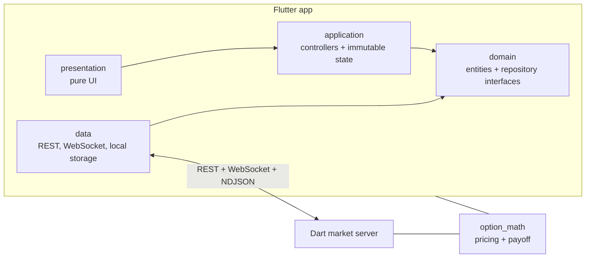
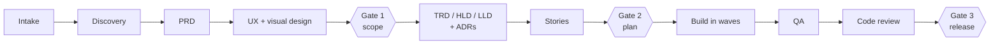
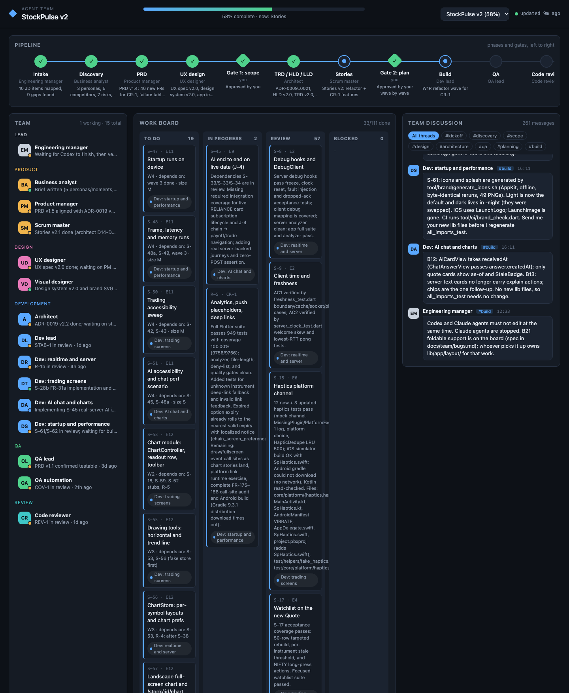

# StockPulse

A mobile-first trading app for Indian equity and F&O traders, built in Flutter with a live Dart market server. It covers watchlists, Kite-style charts, an option chain with greeks, order entry, portfolio and P&L, price alerts, and an AI assistant that answers with live cards.

The whole project, from the PRD to the code, was built by a **team of AI agents** working through a gated pipeline. A live dashboard showed every phase, discussion, task and sign-off. [How it was built](#how-it-was-built-a-multi-agent-team) explains the setup.

> All market data is **simulated** by the bundled server: no real broker, no real money.

**Demo videos** (iPhone simulator, live data from the bundled server):
- [Watchlist → chart gestures → live option chain](docs/media/01-watchlist-chart-options.mp4)
- [Portfolio → Add funds → Socket Lab reconnect → AI chat with live cards](docs/media/02-portfolio-funds-socketlab-ai.mp4)

**Android APK:** [Releases](../../releases). The app needs the market server running (see [Run it](#run-it)). On a phone, build with `--dart-define=SERVER_HOST=<your computer's IP>`. Without a server it opens with cached data and shows Offline.

---

## What it does

| Area | What works |
|---|---|
| **Watchlist** | Live prices over a WebSocket, advancing/declining summary, favourites pinned to the top, drag to reorder in Edit mode, cached first frame on launch |
| **Stock page** | Candles, Heikin-Ashi, OHLC, line and area charts. Ranges from 1D to 5Y and intervals from 1m to 1w. Pinch, pan, fling, double-tap reset, long-press crosshair. Depth, stats, Buy/Sell |
| **Indicators** | SMA, EMA, VWAP, RSI pane, Bollinger Bands, MACD; up to 4 studies per chart, saved per symbol |
| **Option chain** | NIFTY and stock options across several expiries. Calls and puts with LTP, OI bars and ΔOI. ATM row marked, opens centred on ATM, greeks |
| **Order entry** | Market, limit and SL orders; MIS/CNC/NRML products; lots for F&O. Blocks orders on stale prices. Same-key retries, a "checking status" step and Pending orders that reconcile later |
| **Portfolio** | Positions, holdings and orders with live P&L. Tap a row to **Buy more** or **Exit**. Funds, plus an **Add funds** flow (simulated UPI and net banking) |
| **Alerts** | Price alerts evaluated on the server and delivered over the socket, one banner at a time |
| **AI assistant** | Ask in plain English ("How is RELIANCE doing today?", "Explain theta"). Answers stream in as live cards: quotes, mini charts, chain snippets, payoffs, tables. Attachments, suggested prompts, retry only on failed answers, history kept on the device |
| **Strategy builder** | Up to 4 option legs, payoff at expiry and today, breakevens, max profit and max loss |
| **Responsive** | Bottom bar on phones, navigation rail on tablets, two panes on desktop and web |
| **Developer tools** | Socket Lab shows raw frames and can drop, freeze or skip sequence numbers on purpose. A debug market clock jumps through pre-open, open, close and expiry |

## Real-time engineering

- **One WebSocket, many channels** (quotes, option chain, orders, alerts). Every frame carries a sequence number and an `asOf` time. A gap triggers a resync: a REST snapshot, then deltas.
- **Never trade on a stale price.** Freshness is measured against server time, using a clock offset from the handshake. A price older than 5 s blocks the order and says why.
- **Reconnects that hold up:**
  - exponential backoff with jitter;
  - heartbeat and half-open detection;
  - subscriptions counted by reference and restored after a reconnect;
  - streams paused while the app is in the background or a screen is hidden.
- **Rebuilds stay small.** Each widget watches only its slice of state (`select`), ticks are batched per frame, and the 82-cell option chain does not rebuild on keep-alive frames.
- **Instant start.** `main()` awaits nothing before `runApp`. The first frame shows the cached watchlist marked as stale, and live data replaces it as it arrives.
- **The server** simulates the market:
  - a market clock with phases, holidays and expiry settlement;
  - Black-Scholes pricing on a volatility smile;
  - idempotent orders;
  - conflation to 4 updates per second.

## Architecture



| Rule | How it is enforced |
|---|---|
| Clean architecture with an application layer: widgets render state and call controller methods | Layer test in `test/architecture` |
| Dependency injection in `di/` folders; providers live at feature level, never in controller files | Review + layer test |
| Routing through a sealed `AppRoute` with go_router, ready for deep links and push placeholders | Route tests |
| `Success` / `Failure` results with typed `AppError`; user text from `AppStrings` (localisation-ready) | Deny-list check |
| Package imports, one public widget per file, **no file over 300 lines** | `tool/ci/file_length_check.dart` |
| No code generation: hand-written Riverpod 3 providers, immutable classes and JSON | Deny-list check |
| Generic analytics with pluggable sinks; a single feedback service so only one snackbar shows | ADR-0017, ADR-0019 |

21 architecture decision records are in [`docs/adr`](docs/adr).

## Quality

| Check | Result |
|---|---|
| Tests | **1,305**: app 997, server 268, option_math 40 |
| Line coverage | **100%** of `stock_pulse/lib`, with an import test so no file escapes |
| Static analysis | `flutter analyze --fatal-infos` clean, with a strict shared lint set |
| File size | 0 files over 300 lines |
| Layer rules | 0 violations |

Every feature was written test-first, and the server has its own end-to-end tests over real sockets.

## Run it

You need Flutter 3.47+ (Dart 3.13+).

```bash
# 1. Start the simulated market server
cd market_server && dart pub get && dart run bin/server.dart --port 8080
```

```bash
# 2. Run the app (iOS simulator, Android emulator, macOS or web)
cd stock_pulse && flutter pub get && flutter run
```

On an Android emulator the app reaches the server at `10.0.2.2`. On a real phone, pass your computer's address: `flutter run --dart-define=SERVER_HOST=192.168.x.x`.

```bash
# Tests and checks
cd stock_pulse && flutter test --coverage && dart run tool/ci/coverage_check.dart coverage/lcov.info
cd market_server && dart test
```

## How it was built: a multi-agent team

StockPulse was built by AI agents playing a software team. The human (me) acted as the product owner: I approved the gates and raised change requests. The agents were Claude Code subagents run by an "engineering manager" agent; later build stories were also done with OpenAI Codex.

### The team

| Team | Roles |
|---|---|
| Product | Business analyst, product manager, scrum master |
| Design | UX designer, visual designer |
| Development | Architect, dev lead, four developers (real-time and server, trading screens, AI and charts, startup and performance) |
| QA | QA lead, QA automation |
| Review | Code reviewer |

### The pipeline



- **Agents discuss before they decide.** For the architecture, four developers each wrote a proposal and critiqued each other's. Then the architect decided, and recorded the disagreements in ADRs.
- **Reviews go round until they pass.** The architect and QA reviewed the PRD and raised 12 High issues, and the PM revised it until both confirmed. Design sign-off took two rounds.
- **Sign-offs.** Product, design, engineering and QA each sign against a written checklist. The human approves three gates.
- **Change requests mid-build.** I raised two change requests with 34 points: Kite-style charts, an application layer, go_router, 300-line files, localisation, analytics, foldables and more. Each went through product, design and architecture before a refactor wave.
- **Honest verification.** The manager re-ran every check itself before marking work done, and tested the app in the simulator. Bugs found there went back into the pipeline.

### Mission-control dashboard

Every agent logged its status, messages, tasks and sign-offs to an append-only event log through a small CLI. A local dashboard (pure Python plus a vanilla JS page) shows:

- the pipeline and its gates;
- each agent's status;
- a kanban board of tasks;
- the discussion threads;
- sign-offs, documents and an activity timeline.

| Measure | Count |
|---|---|
| Events logged | 1,042 |
| Agent-to-agent messages | 261, in 8 threads (most in architecture and build) |
| Documents produced | 64 (PRD, UX spec, design system, TRD, HLD, 4 LLDs, 21 ADRs, stories, reviews) |
| Roles | 15 |



The tooling is in [`tools/agent-team`](tools/agent-team): the skill that defines the process, the event CLI and the dashboard. To open this project's dashboard:

```bash
python3 tools/agent-team/scripts/team.py init --dir docs/team --root . --name "StockPulse v2" --id stockpulse
python3 tools/agent-team/scripts/team.py serve --port 8095   # then open http://localhost:8095
```

## Roadmap

Planned stories not built yet:

- **Chart tools:** drawing tools (horizontal and trend lines), Fibonacci, a landscape full-screen chart with Buy/Sell, alerts and limit orders at a price on the chart.
- **Failure-case suites** for every screen.
- **Foldable-phone layouts:** hinge-aware panes and tabletop posture.
- **Device runs** for startup, frame time and latency.
- **Accessibility sweeps.**

## Repository layout

```
stock_pulse/        Flutter app (feature-first, 4 layers per feature)
market_server/      Dart market server: REST, WebSocket, NDJSON AI stream, market clock, broker
packages/option_math/  Black-Scholes pricing and option payoff maths, shared by app and server
docs/               PRD, UX spec, design system, TRD, HLD, LLDs, ADRs, stories, reviews
docs/team/          The agent team's event log, briefs, bug list and reviews
tools/agent-team/   The multi-agent process, event CLI and dashboard
```
