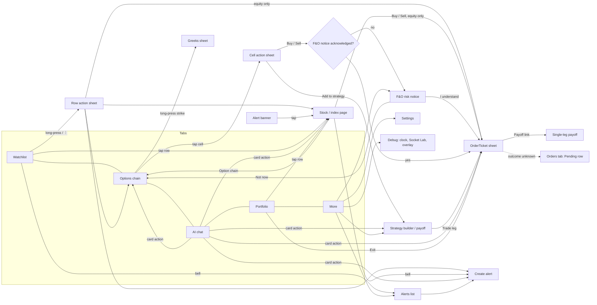

# 03 · UX spec: StockPulse v2 (v2.0)

Owner: ux-designer · Status: **v2.0**, CR-1 update for design review · Input: `02-prd.md` v1.4, `09-change-request-1.md`, `team/reviews/kite-chart-study.md`, `01-brief.md` · Pairs with: `03b-design-system.md` v1.4 (ui-designer) · Next: HLD v2, LLDs, stories

> Reference frame: phone portrait, **360 × 800 dp** (works to 400 dp). Wireframes are 40 characters wide ≈ 360 dp.
> Every price on screen is simulated; every AI card says so (FR-62).
> Component names are the design-system names (`03b` §5); `Sp` prefix in code.
> All copy in this spec is English source text for ARB keys (part 15); no screen hard-codes strings.

## Parts (v2.0)

This file keeps the v1 screens (§1–§9). CR-1 additions live in part files under `03-ux-spec/`:

| Part | File | Covers |
|---|---|---|
| 10 | `03-ux-spec/10-chart.md` | Kite-style chart: toolbar (portrait + landscape), studies, readout, crosshair menu, drawings, Buy/Sell from chart, states |
| 11 | `03-ux-spec/11-picker.md` | `SpPicker`: where it appears, sheet vs segmented rules, keyboard and accessibility |
| 12 | `03-ux-spec/12-feedback.md` | One snackbar at a time; inline vs banner vs snackbar vs dialog; copy patterns and keys |
| 13 | `03-ux-spec/13-links-push.md` | Deep-link entry points, back stack, invalid links; push tap flows; permission in context |
| 14 | `03-ux-spec/14-failures.md` | F1–F18 mapped to what each screen shows; F9 empty states; load states |
| 15 | `03-ux-spec/15-strings-startup.md` | Localisation rules, copy tone rules; native splash and first launch |

## Change log v2.0 (CR-1, 7 Nov 2026)

| # | Change | Driven by |
|---|---|---|
| U13 | **Chart, Kite-style** (part 10): readout + study chips above the plot, range + 6-button `ChartToolbar` below it (nearer the thumb); studies sheet (SMA/EMA/VWAP/RSI Must, BB/MACD Should, Supertrend Could), limits 4 studies / 2 panes; pinned crosshair with `⋯` menu (alert / limit at price, Should); horizontal + trend line with one-shot draw mode, 44 dp handles, auto-save per symbol; landscape full screen with tools on the left rail and Sell/Buy on the right rail; ticket opens as a side sheet in landscape | PRD C19, FR-130…152, NFR-23 |
| U14 | Chart labels change only when their data is painted; failed interval load reverts with a snackbar | UX principle (never act on wrong information) |
| U15 | **`SpPicker`** (part 11) replaces every dropdown; segmented for ≤ 4 short options, sheet list otherwise, automatic fallback at large text | PRD C20, FR-155 |
| U16 | **One snackbar at a time** (part 12): channel rules; states never use snackbars (disabled Confirm tap = reason focus + haptic); drop same key < 4 s, replace by priority, one waiting slot | PRD C21, FR-156, FR-157, F17 |
| U17 | **Deep links and push taps** (part 13): 11 entry points with back stack and invalid handling; trade links never guess a side; open ticket closes for a link unless Placing; permission explainer after the first alert | PRD C26, FR-175…181 |
| U18 | **Failure map** F1–F18 per screen and F9 empty states (part 14) | PRD C24, §7a, NFR-21 |
| U19 | **Strings and tone** rules, **native splash and first launch** without prompts or spinners (part 15) | PRD C22, C23, FR-160…172, NFR-22 |
| U20 | §3.2 chart row and §3.3/§9 R5 updated: interval/type via `SpPicker`, ATM row 48 dp (03b v1.4) | 03b T1 |
| U21 | Open questions Q-UX-1…3 for the PM (§9) | ux-designer |

## Change log v1.1

| # | Change | Driven by |
|---|---|---|
| U1 | Stale rule follows PRD §3.1: age = server-adjusted now − `asOf` (last server confirmation, keep-alive ≤ 2 s); stale when age **> 5.0 s** (5.0 s is live); quiet strikes stay live | PRD C1, FR-91, FR-94, 03b 5.7a |
| U2 | Only the **traded contract** blocks Confirm; a stale underlying with a live contract shows a nudge (E20) | PRD §3.1 |
| U3 | New submit states: **Placing… → Checking status…**, then **Pending** in Orders for an unknown outcome; no Retry, only Refresh status; never auto-resubmit | FR-31, FR-31a, FR-38a, 03b 5.5a/b |
| U4 | Chain fixed at **41 strikes (ATM ±20)**; rows keyed by strike, ATM is a highlight, list never auto-scrolls | FR-20, FR-23 |
| U5 | **NIFTY index**: no Buy/Sell bar, no depth; row actions Chart / Option chain / Set alert only | FR-4, FR-6 |
| U6 | **Demo clock** (default): second pill next to the phase pill; debug clock presets 09:14:50, 15:19:50, 15:29:50, next day | FR-14, FR-111, FR-116 |
| U7 | My 8 questions answered and folded in (§9): no swipe, block at Confirm, last-viewed underlying, per-tab summary, "Not now", no extra grace, AI relies on the sheet, banner queue + bell dot | PRD C12 |
| U8 | Component names aligned to 03b; Buy = blue `accent`, Sell = red `down`; "Funds available" (no margin row), "Margin not simulated" on short sells | PRD C13, 03b 5.5 |
| U9 | Added: expiry settlement notice (FR-49), alert dedupe per `alertId` (FR-55), resync behaviour, AI Stop/cancel (FR-67), CNC holdings/funds rejections, 50-equity search | FR-49, 55, 67, 39, 39a, 7 |
| U12 | v1.3: Refresh status on Pending rows disabled ("Waiting for connection") only when Offline; enabled while Reconnecting (REST may answer); R7 resolved in 03b v1.3 | PM R6 answer, FR-31a |
| U11 | v1.2: R1–R5 resolved in 03b v1.2; `StaleBadge` copy "Stale since hh:mm:ss"; default-states rule added to §3 | 03b v1.2, design sign-off |
| U10 | Motion aligned to 03b §6: no animation on prices, OI bars, ATM highlight or ATM scroll; no shimmer | 03b §6 |

---

## 1. Information architecture

### 1.1 Bottom navigation (5 tabs, Material 3 `NavigationBar`, 80 dp tall) — decided in PRD v1.1

| # | Tab | Icon | Root screen | Built at startup? (FR-82) | Why it is a tab |
|---|---|---|---|---|---|
| 1 | **Watchlist** | `show_chart` | Watchlist | Yes (cache-first) | Home; 50+ opens a day start here (Arjun) |
| 2 | **Options** | `stacked_bar_chart` | Option chain, **last viewed** underlying; first visit opens the underlying chooser (FR-29b) | No, first visit | Chain is where the competition is; the selected underlying persists |
| 3 | **AI** | `auto_awesome` | AI chat | No, first visit | Rohan's entry point (M8) |
| 4 | **Portfolio** | `account_balance_wallet_outlined` | Positions / Holdings / Orders + summary card | Yes (cache-first) | Meera's P&L check (M6) |
| 5 | **More** | `menu` | Alerts, Strategy builder, F&O risk notice, Settings, Debug (clock, Socket Lab, overlay) | No, first visit | Low-frequency and debug tools |

A tab is built on first visit and kept alive afterwards (scroll kept). Hidden tabs and covered routes release their
price streams (FR-86) and resubscribe when visible again; on resubscribe their prices show stale until the first frame.

**Global chrome on every tab root:** app bar with title, `MarketStatusPill`, Demo clock chip (when the virtual clock
is on, i.e. by default in dev/profile), `ConnectionBadge`; the `StaleBadge` banner variant slides in under the app bar
when FR-90 fires. Below 1.3× text the two pills share one line; above, they stack in an app-bar bottom row.
Alert banners sit under the app bar (§3.6); `SpSnack` notices appear **above** the nav bar, one at a time (part 12), and never over an open sheet's Confirm bar.

### 1.2 Navigation map



Rules: the order ticket is always a **modal bottom sheet** (`SpSheet`) on top of whatever opened it, so closing it
returns the trader to the exact place (chain scroll, chat position). Deep pushes are at most 2 levels from a tab root.

---

## 2. Screen list

Thumb reach on 360 × 800: **Easy** = bottom 40% (y > 480 dp), **Stretch** = middle, **Hard** = top 25%.

| Screen | Purpose | FR IDs | Primary action | Thumb |
|---|---|---|---|---|
| Watchlist | Scan live prices, jump to a stock | FR-1–7, FR-80–83, FR-90–91 | Tap row; long-press / `⋮` → actions | Rows anywhere |
| Stock page (equity) | Chart, depth, stats, trade | FR-10–14, FR-52 | Buy / Sell | Sticky bottom bar, Easy |
| Index page (NIFTY) | Chart, stats, go to chain | FR-6, FR-10, FR-13 | Option chain | Sticky bottom bar (single button), Easy |
| Option chain | Read ATM, OI, buy a strike | FR-20–29c | Tap CE/PE cell → Buy/Sell | ATM at ~55% height; Back to ATM FAB Easy |
| Cell action sheet | Buy / Sell / Add to strategy / Greeks / Alert | FR-26, 27, 29 | Buy / Sell | Bottom sheet, Easy |
| OrderTicket (equity) | Market / limit / SL | FR-30–31a, FR-34–39a | Confirm | Pinned bottom, Easy |
| OrderTicket (F&O) | Lots, product, ₹ value | FR-32–33, FR-36–38a, FR-70 | Confirm | Pinned bottom, Easy |
| F&O risk notice | One-time disclosure | FR-113 | I understand | Pinned bottom, Easy |
| Positions | Live P&L, exit | FR-40–44, FR-49 | Exit | Row trailing button |
| Holdings | Day vs total P&L | FR-45–47 | Tap row → stock page | Rows |
| Orders | Status, cancel, Pending | FR-31a, FR-48 | Cancel / Refresh status | Row trailing |
| Alerts list / create | Status, delete / above-below | FR-50–55 | New alert / Save | FAB / pinned bottom, Easy |
| Alert banner | Trigger notice | FR-51, 52, 54, 55 | Tap → stock page | Above nav bar, Easy |
| AI chat | Ask, get live cards | FR-60–67 | Send / chip / Stop | Composer at bottom, Easy |
| Strategy builder / payoff | Legs, payoff, max loss | FR-70–73 | Trade leg | Leg rows, Easy |
| Settings / Debug | Haptics, clock, reset, Lab | FR-102, FR-110–116 | Toggles | List |

---

## 3. Screens

States legend: **Load** · **Empty** · **Err** · **Stale** · **Off** offline · **Closed** · **Pre** pre-open.
Default for any state a screen's table does not list: Load = static placeholders; Err = inline `ErrorView` with Retry; Stale/Off = cached content with `StaleBadge` and the stale banner, server actions disabled with "Needs connection"; Closed/Pre = `MarketStatusPill` shows the phase, prices "Closed · as of", trading blocked only in the ticket. Settings/Debug have no price states; Market clock and Reset are disabled offline ("Needs connection").

### 3.1 Watchlist

```
┌────────────────────────────────────────┐
│ Watchlist [●Open][⏲Demo 10:02][Live] 🔔│ app bar; bell dot if alert queued
│ ▓ ⏱ Prices not live since 09:31:07  ⟳ ▓│ StaleBadge banner (FR-90 only)
├────────────────────────────────────────┤
│ NIFTY  ·IDX                24,512.35  │ QuoteRow 56dp
│ Nifty 50                 ▲ +84.20 +0.34%│
├────────────────────────────────────────┤
│ RELIANCE  ·F&O              1,486.10  │
│ Reliance Industries     ▼ −6.40 −0.43% │
├────────────────────────────────────────┤
│ HDFCBANK ·F&O               1,702.00  │ stale row: price dimmed,
│ ⏱ Stale since 09:31:02              ⋮ │ StaleBadge replaces name line
├────────────────────────────────────────┤
│ Watch  Options  AI   Portfolio  More  │ nav 80dp
└────────────────────────────────────────┘
```

- `QuoteRow`: symbol + segment tag; `PriceCell` (LTP, `textPrimary`) and `ChangeChip` (arrow, signed change, %). `⋮` (48 × 48) opens the same action sheet as long-press.
- **Row action sheet (FR-4):** equities: Chart · Option chain (if it has options) · Set alert · **Sell · Buy** (Buy/Sell last, nearest the thumb, Buy blue, Sell red). **NIFTY index:** Chart · Option chain · Set alert only. **No swipe actions.**
- Search (🔍 in the overflow) finds any of the 50 simulated equities + NIFTY and adds them (FR-7).
- A row turns live on its own first live frame (J-1); other rows are untouched.

| State | Behaviour |
|---|---|
| Load (no cache) | 8 static placeholder rows (no shimmer); badge "Reconnecting"; never zeros (E1) |
| Load (cache) | Cached rows painted at once, stale style "as of 15:30 yday" until each row's first live frame (FR-80/81) |
| Empty | `EmptyView` "Watchlist is empty. Add a stock" + "Restore NIFTY, RELIANCE, HDFCBANK" |
| Err | `ErrorView` inline "Couldn't load watchlist · Retry"; cached rows stay |
| Stale | Per row when its age > 5.0 s (only that row, E3); all rows + banner when socket not live > 5 s |
| Off | Badge Offline; banner; all rows stale; action-sheet Buy/Sell open the ticket, blocked there |
| Closed | Pill Closed; rows in normal colours, "Closed · as of 15:30:00"; not stale |
| Pre | Pill Pre-open; equities show drifting IEP labelled "IEP"; NIFTY shows previous close |

### 3.2 Stock page (equity) and index page (NIFTY)

```
Equity (RELIANCE)                          Index (NIFTY)
┌──────────────────────────────────┐     ┌──────────────────────────────────┐
│ ← RELIANCE  [●Open][Live]     🔔 │     │ ← NIFTY 50  [●Open][Live]     🔔 │
│ ₹1,486.10   ▼ −6.40 (−0.43%)     │     │ 24,512.35  ▲ +84.20 (+0.34%)     │
│ as of 10:02:14                   │     │ as of 10:02:14 · Index           │
│ readout + study chips (part 10)  │     │ [1D]…  chart (part 10)           │
│ ┌ chart, live last candle ─────┐ │     │ Stats: open, high, low, prev cl. │
│ └──────────────────────────────┘ │     │ (no depth panel)                 │
│ [1D]…[5Y] [5m▾][Candle▾][ƒx]…[⤢] │     │                                  │
│ [Option chain ›] [Set alert ›]   │     │ [Set alert ›]                    │
│ Market depth (5) · Stats         │     │                                  │
├──────────────────────────────────┤     ├──────────────────────────────────┤
│ [    BUY (blue) ] [ SELL (red) ] │     │ [        Option chain  ›       ] │
└──────────────────────────────────┘     └──────────────────────────────────┘
```

- The chart (readout, studies, drawings, toolbar, full screen) is specified in **part 10**; this section keeps the page around it.
- Equity Buy/Sell stay **enabled** in every state (FR-12); the ticket explains any block. E10 (contract data missing) is the only button-level disable, with caption.
- Index pages never show Buy/Sell or depth (FR-6); the bottom bar is a single "Option chain" button so the thumb action is still there.
- From an alert banner (FR-52) a dismissible strip "Alert hit: ≥ 1,500.00 at 10:02:11" sits above the bar; Buy/Sell is 1 tap.

| State | Behaviour |
|---|---|
| Load | Header placeholder; chart box with one spinner; bar visible, buttons wait for metadata |
| Err | "Chart unavailable · Retry" inside the chart box; header still live |
| Stale / Off | `PriceCell` dimmed + `StaleBadge` "Stale since hh:mm:ss"; cached candles, last candle frozen |
| Closed / Pre | Pill; "Closed · as of 15:30:00"; Pre shows IEP line (equity only) |

### 3.3 Option chain (Options tab)

```
┌────────────────────────────────────────┐
│ NIFTY ▾ 24,512.35 ▲+0.34% [●Open][Live]│ header, underlying live (FR-25)
│ [11 Nov · Expires today] [18 Nov]   ⚙  │ expiry chips + column picker
│ PCR 0.92 · Max pain 24,500 · lot 65    │ (FR-28, Could)
├──────────── CALLS ┬───────┬ PUTS ──────┤
│ OI     ΔOI   LTP  │STRIKE │ LTP  ΔOI  OI│ sticky header; ⚙ = SpPicker multi-select
├───────────────────┼───────┼────────────┤
│▒12.4L +1.2 312.40▒│24,300 │ 41.15 −0.3 8.1L│ ▒ = ITM call tint
│▒ 9.8L +0.8 268.05▒│24,350 │ 52.60 +0.1 7.4L│
│▒ 7.1L −0.4 182.90▒│24,450 │ 79.30 +0.9 9.9L│
│ 15.2L +3.1 141.25 │━24,500━│ 98.75 +2.4 14.0L│ ATM: surface2 strike cell, accent rules, "ATM"
│  6.0L +0.2 104.10 │24,550 │▒126.40 …     ▒│ ▒ = ITM put tint
│ …  41 rows total (ATM ±20)             │
│                       ( ◎ Back to ATM ) │ FAB, only when ATM off-screen
├────────────────────────────────────────┤
│ nav bar                                │
└────────────────────────────────────────┘
```

- `ChainRow` per 03b 5.4: CE | strike | PE, 36/28/36%. Default per side: **OI (lakhs + `OiBar`), ΔOI, LTP**; LTP next to the strike. Column picker adds IV (1 dp) and Δ; with extra columns each side scrolls horizontally in sync, strike pinned. Row height **48 dp** (each cell is a tap target).
- 41 fixed strikes per expiry per day (FR-20). When spot moves, the **highlight moves; rows never re-order or re-index**, and the list never auto-scrolls (FR-23).
- Quiet deep-OTM strikes look exactly like live cells (03b 5.7a); only age > 5.0 s greys a cell.
- **Tap a cell** → cell action sheet: "NIFTY 11 Nov 24500 CE · LTP 141.25 · lot 65"; Add to strategy · Greeks · Set alert · **Sell · Buy** (56 dp, bottom). Tap count cell (1) → Buy (2) → Confirm (3) = J-2.
- Long-press strike → Greeks sheet (FR-27). Underlying ▾ switches NIFTY / RELIANCE / HDFCBANK and is remembered (FR-29b).
- Opened from stock page or AI card: Options tab switches to that underlying/expiry with the target strike centred and its cell selected (2 dp accent outline, static).

| State | Behaviour |
|---|---|
| Load | Header live first; placeholder rows with an empty ATM marker |
| Empty | "No options for this instrument" (bad deep link only) |
| Err | `ErrorView` "Chain unavailable · Retry"; header stays |
| Stale | Only cells with age > 5.0 s dim; socket-level → whole chain dims + banner. Cell taps still open the sheet (blocked there) |
| Off | Last snapshot dimmed with "as of" |
| Closed | Normal colours, "Closed · as of 15:30"; ticket shows "Market closed" |
| Pre | Banner "Options open at 09:15" (FR-37); cells show previous close, frozen |
| Expired (FR-29c) | Expired chip shows `Expired` badge, cells disabled, picker moves to the next expiry within 1 s, `SpSnack` "11 Nov expired · showing 18 Nov" |

### 3.4 OrderTicket (equity and F&O)

`SpSheet`, up to 90% height. Confirm pinned outside the scroll area, above the keyboard.

```
Equity                                    F&O
┌──────────────────────────────────┐     ┌──────────────────────────────────┐
│ ── RELIANCE · NSE   ₹1,486.10 ▼  │     │ ── NIFTY 11 Nov 24500 CE  141.25 ▲│
│    as of 10:02:14                │     │    lot 65 · Expires today         │
│ [ BUY | SELL ]                   │     │ [ BUY | SELL ]   From AI chat     │
│ Product [ CNC | MIS ]            │     │ Product [ NRML | MIS ]            │
│ Type [Market|Limit|SL]           │     │ Type [Market|Limit|SL]            │
│ Qty   [ − ]   10   [ + ]         │     │ Lots  [ − ]   2   [ + ]           │
│ Price [ 1,480.00 ]               │     │ = 130 qty · ₹18,362.50            │
│  Band 1,193.60–1,790.40          │     │ Price [ 141.25 ]  Band 0.05–420.0 │
│ Order value ₹14,800.00           │     │ Max loss ₹18,362.50 · Payoff ›   │
│ Funds available ₹10,00,000.00    │     │ Funds available ₹10,00,000.00     │
│ ⚠ Order is 26% of demo funds  ✕  │     │ ⚠ Contract expires today       ✕  │
│ ⓘ Price not live since 10:02:14  │     │ ⚠ Underlying not live (nudge)  ✕  │
│ [   BUY 10 RELIANCE @ 1,480.00 ] │     │ [ BUY 2 lots NIFTY 24500 CE    ]  │
└──────────────────────────────────┘     └──────────────────────────────────┘
```

- `SegmentedChoice` for side, product, type. F&O offers MIS / NRML only (CNC hidden). Default CNC / NRML (FR-32).
- `LotStepper` (48 dp −/+, long-press repeats); units and ₹ order value recalculated on one line (FR-33). Lot size, tick and band come from metadata and the band range is shown under the price (FR-34).
- Summary rows: Order value, **Funds available**, Max loss (F&O buys). Short option sells show "Margin not simulated" caption (FR-39). No margin row.
- Inline field errors (tick, band, SL trigger rule). Server rejections (`price_band`, `insufficient_funds`, `insufficient_holdings`, `market_closed`) appear as an inline banner at the top of the sheet and the sheet scrolls to it; rejection haptic (FR-30, E7).
- Nudges (`warnTint` strips, ✕) never disable Confirm: limit > 3% from LTP, value > 25% of funds, expires today, **underlying price not live** (E20).
- Confirm label repeats the order (side-coloured: Buy blue, Sell red, 52 dp). The reason line for a disabled Confirm sits **directly above** it (03b 5.15).
- First F&O ticket → F&O risk notice first (3.10).

| State | Confirm | Reason line above Confirm |
|---|---|---|
| Live, valid | Enabled | — |
| Invalid input | Disabled | Field error, e.g. "Price must be a multiple of 0.05" |
| Traded contract stale (D-4, age > 5.0 s) | Disabled, inputs kept (E5) | "Price not live since hh:mm:ss" (FR-38) |
| Underlying stale, contract live | **Enabled** | none; nudge strip instead (E20) |
| Offline | Disabled | "Offline · reconnecting…" |
| Closed | Disabled | "Market closed · opens 09:15" |
| Pre, equity | Market segment disabled; Limit enabled (queued, fills at 09:15 if crossed) | "Pre-open: limit orders only, matched at 09:15" |
| Pre, option | Disabled; enables at 09:15:00.000 without reopening | "Options open at 09:15" (FR-37) |
| Contract data missing (E10) | Disabled | "Contract data unavailable" |
| **Placing** (FR-31a) | Locked: spinner + "Placing…"; after 3 s "Checking status…" | — (sheet cannot be dismissed, back ignored) |
| Back to live (FR-92) | Re-enabled on the first live frame | reason line removed |

**Submit outcomes:**
- **Filled / accepted:** sheet closes; `SpSnack` "Filled: Bought 130 NIFTY 24500 CE at 141.25 · View"; success haptic once (FR-100).
- **Rejected:** sheet stays, inline banner with the reason, rejection haptic.
- **Stale after send (FR-38a):** the in-flight order is **not** cancelled; the sheet stays in Placing/Checking until the outcome is known.
- **Unknown after 2 retries (FR-31a):** sheet closes; `SpSnack` "Order status unknown. See Orders · View" (6 s). Orders shows the row with a `PendingBadge` (info colour, hourglass, "Pending"), action **Refresh status** only (disabled with "Waiting for connection" when Offline, enabled while Reconnecting); never Retry. Resync swaps it to Filled/Rejected with one notice and one haptic.
- **App killed mid-submit:** on relaunch Orders shows the server truth; nothing resubmits (E18).

### 3.5 Portfolio: summary card, Positions, Holdings, Orders

```
┌────────────────────────────────────────┐
│ Portfolio     [●Open][⏲Demo][Live]     │
│ ┌ Holdings ──────────────────────────┐ │ summary card follows the tab (FR-47)
│ │ Invested ₹4,10,200  Current ₹4,32,950│
│ │ Day P&L   ▲ +₹2,140.50 (+0.50%)    │ │
│ │ Total P&L ▲ +₹22,750.00 (+5.55%)   │ │
│ │ Funds available ₹9,81,637.50       │ │
│ └────────────────────────────────────┘ │
│ [ Positions (3) | Holdings (5) | Orders]│
├────────────────────────────────────────┤
│ NIFTY 24500 CE           ▲ +₹1,215.50  │
│ NRML · 2 lots · avg 141.25  LTP 150.60 │
│ [Expires today]               [ Exit ] │
├────────────────────────────────────────┤
│ RELIANCE  MIS · 10 qty    ▼ −₹64.00    │ (symbol, product) rows,
│ [Auto square-off 15:20]       [ Exit ] │  MIS and CNC never netted
└────────────────────────────────────────┘
```

- Summary card: Holdings tab → invested, current, Day, Total; Positions tab → "Today: realised + unrealised"; funds on both. Labels always say **Day** / **Total** (FR-45).
- Positions keyed by (symbol, product) (FR-41). **Exit** (48 dp) opens the opposite-side ticket with the full quantity/lots (FR-42).
- Orders: v1 list with Cancel for open orders; `PendingBadge` rows with Refresh status (3.4).
- System events as `SpSnack` + an info row in Orders: "MIS RELIANCE squared off at 15:20" (FR-44); "NIFTY 11 Nov 24500 CE settled at intrinsic ₹6,500.00" at 15:30 on expiry day, the position moves to realised P&L (FR-49).
- After a reconnect resync, orders, positions and alerts reload; a fill already announced is never announced again.

| State | Behaviour |
|---|---|
| Load | Cached summary + rows in stale style; placeholders if no cache |
| Empty | Positions: "No open positions · Open the chain ›"; Holdings: "Shares bought with CNC show here the next trading day" (teaches T+1) |
| Err | `ErrorView` inline; cached data stays |
| Stale / Off | P&L dimmed with "as of"; Exit opens the ticket (blocked there) |
| Closed | P&L frozen at close, "Closed · as of 15:30" |

### 3.6 Alerts list, create, banner

```
List                                     Create (SpSheet)
┌──────────────────────────────────┐     ┌──────────────────────────────────┐
│ ← Alerts                         │     │ ── Alert for RELIANCE  1,486.10 ▼│
│ Active (2)                       │     │ [ Above ≥ | Below ≤ ]            │
│ RELIANCE ≥ 1,500.00   LTP 1,486 ⋮│     │ Price [ 1,500.00 ]  +0.94% away  │
│ NIFTY ≤ 24,300.00     LTP 24,512⋮│     │ One-shot: fires once, then stops │
│ Triggered                        │     │                                  │
│ HDFCBANK ≥ 1,700 · hit 09:58:10 ⋮│     │                                  │
│            ( + New alert )       │     │ [          Save alert         ]  │
└──────────────────────────────────┘     └──────────────────────────────────┘
```

- `⋮` → Edit / Delete (4 s Undo `SpSnack`). No swipe-to-delete.
- Create from row actions, stock page bell, AI "Set alert" (prefilled). Validation: tick 0.05; Above must be > LTP, Below < LTP (else "Already above · alert would fire now").
- **Alert banner** (FR-52): 72 dp under the app bar, "RELIANCE crossed ≥ 1,500.00 · now 1,501.20", tap → stock page, auto-hides after 8 s; stays in the list as Triggered.
- **While a sheet is open:** banner is queued until the sheet closes; the bell shows a dot (FR-52, E19).
- **One banner per `alertId`** (FR-55), even if it arrives live and again via resync; ones delivered after reconnect say "(while you were offline)" (FR-54).

States: Load placeholders · Empty `EmptyView` "No alerts yet. Get told when a price crosses a level." · Err retry · Off: cached list, Save disabled "Needs connection".

### 3.7 AI chat

```
┌────────────────────────────────────────┐
│ AI · Simulated  [Live]         ⟲ New   │
├────────────────────────────────────────┤
│                 What does the NIFTY ▸ │ user bubble (accent), right
│                 chain say?            │
│ ┌ AiCardShell · Quote ── as of 10:02 ┐ │
│ │ NIFTY 24,512.35 ▲+0.34%            │ │ live (FR-63)
│ ├ AiCardShell · NIFTY chain ─────────┤ │
│ │ PCR 0.92 · Max OI CE 24,600 PE 24,400│
│ │ 24,400 │━24,500━│ 24,600 mini rows │ │
│ │ [Open chain] [Trade this strike]   │ │ 48dp TextButtons
│ ├ AiCardShell · Explanation ─────────┤ │
│ │ Calls are being written at 24,600… │ │ streams
│ │ Simulated. Not advice.             │ │ footer on every card
│ └────────────────────────────────────┘ │
│ [Explain theta] [Top movers] [Compare…]│ chips, h-scroll
│ ┌──────────────────────────────┐ (■) │ Send ➤ becomes Stop ■ while streaming
└────────────────────────────────────────┘
```

See §7. States: first open = greeting + chips; Err mid-stream → received cards stay + error card "Answer interrupted · Retry" (FR-67, E13); Off: composer disabled "Chat needs connection", history readable; Stale/Closed: embedded prices follow §4.

### 3.8 Strategy builder and payoff

```
┌────────────────────────────────────────┐
│ ← Strategy · NIFTY 11 Nov    lot 65    │
│ ┌ PayoffChart ───────────────────────┐ │ 220dp
│ │ ₹  \            /   — at expiry    │ │
│ │ 0 ──\────┼─────/──  ┄ today        │ │
│ │       \__│__ /      │ spot 24,512  │ │
│ │  tooltip: at 24,700 → +₹3,900      │ │ crosshair (FR-73)
│ └────────────────────────────────────┘ │
│ [Max profit Unlimited] [Max loss ₹15,860]│ chips, text not colour
│ Breakevens 24,256 / 24,744 · Net −₹15,860│
│ Legs (2/4)                             │
│ BUY 1× 24500 CE  141.25   [Trade] [✕] │
│ BUY 1× 24500 PE   98.75   [Trade] [✕] │
│ ( + Add leg from chain )               │
│ ⓘ Preview only · each leg trades alone │
└────────────────────────────────────────┘
```

- Single-leg payoff (FR-70) is this screen with one leg, opened from "Payoff ›" in the ticket; back returns with inputs intact.
- Legs edit inline (side, lots); **Trade** opens a prefilled single-leg ticket (D-3). 5th leg: "Up to 4 legs in preview".
- Crosshair: drag, or tap a point (alternative); tooltip flips side near edges to stay inside 360 dp.

States: Empty "Add legs from the option chain" + Open chain · Stale: expiry payoff still shown, today line hidden "Today line needs live prices" · Err "Couldn't price legs · Retry".

### 3.9 More: settings and debug

```
┌────────────────────────────────────────┐
│ More                                   │
│ 🔔 Alerts                            › │
│ 🧩 Strategy builder                  › │
│ ⚠ F&O risk notice                    › │
│ Settings                               │
│ Haptics on fill               [ ● ]    │ FR-102
│ Reset demo account                   › │ FR-112
│ Debug                                  │
│ Market clock · Demo 10:02:14         › │ FR-111, FR-116
│ Socket Lab                           › │ FR-110
│ Performance overlay           [ ○ ]    │ FR-114
│ About · all data simulated             │
└────────────────────────────────────────┘
```

- **Market clock sheet** (also opened by tapping the Demo clock chip): mode shown (Demo / Real); "Set time" picker; presets **09:14:50** (watch the open), **15:19:50** (square-off), **15:29:50** (settlement), **Next day** (T+1 roll, expiry roll). While demo/override is active the Demo clock chip is always visible (E16).
- **Reset** dialog lists what resets: funds back to ₹10,00,000, orders, positions, holdings, alerts, F&O notice acknowledgement, alert seen-list, cache. Buttons "Cancel" (default) and "Reset".

### 3.10 F&O risk notice

Full-screen route (cannot be flicked away), shown before the first F&O ticket (FR-113). Title "Risk of F&O trading
(simulated)"; 3 short points from brief §5.3 (9 of 10 individual traders lose money; options can expire worthless;
this app uses simulated money). Pinned bottom: **"I understand"** (primary) and **"Not now"** (text) → back to the
chain, notice shows again on the next F&O attempt. Acknowledgement stored locally; re-viewable from More. At 200% the
body scrolls and the buttons stay pinned.

---

## 4. Stale-price pattern (PRD §3.1 and D-4, used everywhere)

`PriceCell` + `ChangeChip` + `StaleBadge` own the look; screens never style stale prices themselves.

| State | Rule | Look | Text |
|---|---|---|---|
| **Live** | socket `live` and (Open → age ≤ 5.0 s); age = server-adjusted now − `asOf` | LTP `textPrimary`; `ChangeChip` up/down colour + ▲/▼ + sign | none in rows; "as of" caption on detail headers |
| **Quiet but live** | No trade for a long time but keep-alive confirms ≤ 2 s | **Identical to live** (03b 5.7a) | none |
| **Stale** | socket not live, or Open and age **> 5.0 s**, or cached value with no live frame since start | Price dimmed, arrow hidden, `StaleBadge` (`warn`, clock icon) | "Stale since hh:mm:ss" (cache: "Stale since 15:30 yday") |
| **Closed** | Pre-open or Closed phase | Normal colours, not dimmed | "Closed · as of 15:30:00" / "Pre-open · IEP" |

- **Banner** (FR-90): `StaleBadge` banner, 36–40 dp under the app bar: "Prices not live since 09:31:07" + ⟳. Shows when no frame for > 5 s while Open or socket not live > 5 s; hides on the first live frame. It pushes content down, never covers it.
- **Per instrument** (FR-91, E3): only that row / cell / card dims; the banner is for socket-level problems.
- **Only the traded contract blocks.** A stale underlying under a live option shows a nudge, not a block (E20).
- **Blocked action explains itself:** the reason line sits directly above the disabled Confirm (icon + `warn` text, AA); the button's semantics label includes the reason. Tapping the disabled button gives a light haptic and focuses the reason; it never just does nothing.
- Stale → live is instant (no fade): the fresh value appears at once and the reason line is removed.
- Detection is within 5.25 s of a freeze (250 ms evaluation); no extra grace period (PRD Q6).

## 5. One-handed rules

1. **Thumb zone:** primary actions (Buy, Sell, Confirm, Exit, Save, Send, I understand, Option chain on index pages) in the bottom 40%, ideally a pinned bar ≥ 52 dp above the system gesture area (NFR-13, FR-12).
2. **Targets:** every tappable thing ≥ 48 × 48 dp, including chain cells (48 dp rows), chips, `LotStepper`, `⋮`. ≥ 8 dp between Buy and Sell.
3. **Money actions are never one tap from a scroll gesture:** Buy/Sell from a row always goes through a sheet; nothing tradeable sits in the top corners.
4. **Back** = system back / edge swipe; sheets also close by drag-down, except the risk notice and a ticket in Placing/Checking.
5. **Gestures (only these), each with an alternative:** long-press row → actions (alt `⋮`); long-press strike → greeks (alt "Greeks" in the cell sheet); drag-down to close sheets (alt back); pull-to-refresh (alt Retry); payoff crosshair drag (alt tap). **No swipe-to-trade, no swipe-to-delete.**
6. Chain header collapses to a 40 dp sticky line on scroll; an "Expiry ▾" chip in the bottom-right lets the thumb change expiry.

## 6. Live data motion rules (aligned to 03b §6)

| Rule | Detail |
|---|---|
| Tick colour | Static: `ChangeChip` colour by change vs prev close (▲ + / ▼ −, flat neutral). LTP text stays `textPrimary` with the optional 1.5 s last-tick tint from 03b 2.3. **No background flash, no blink, no rolling digits.** |
| Repaint scope | Only the changed cell/row repaints (per-row/per-cell `select`, `RepaintBoundary`); tabular figures and fixed-width cells, so layout never shifts. |
| Chain jitter | Fixed column widths; `OiBar` width changes without animation; ΔOI sign swap changes colour only. |
| ATM highlight | Moves instantly to the new strike when spot crosses a midpoint (FR-23); ITM tints move with it. No cross-fade. |
| Scroll to ATM | On open and on expiry change: instant jump so ATM sits at ~55% of the viewport (FR-22). After that **never auto-scroll** (`ScrollController.offset` unchanged, E9). "Back to ATM" FAB when ATM is off-screen: instant jump. |
| Live chart | Last candle updates in place; axis rescales at most once a second. |
| Loading | Static placeholders, no shimmer; one spinner for actions. |
| Reduced motion | OS setting makes sheet/page transitions 0 ms too. |

## 7. AI chat

**Layout:** user bubbles right (`accent`, max 80% width); answers are left-aligned `AiCardShell` cards, full width
(360 − 32 dp). A "Thinking…" row until the first card arrives. Auto-scroll to new cards **only if the user is at the
bottom**; otherwise a "↓ New answer" pill.

| Card | Contents | Live? | Actions (open prefilled screens, D-6) |
|---|---|---|---|
| Text / explanation | Paragraphs, bold terms; terms tappable for "Explain" | No | Explain more |
| Quote | Symbol, LTP, change, as of, phase | Yes | Open stock · Set alert |
| Mini chart | 1D line, 120 dp, last point live | Yes | Open chart |
| Chain snippet | PCR, max-OI strikes, 3–5 rows round ATM | Yes | Open chain (strike centred) · Trade this strike |
| Payoff | Small `PayoffChart` + max profit/loss/breakevens | No (at expiry) | View payoff · Trade this strike |
| Screener table | ≤ 5 rows (top movers / compare) | LTP column | Row → stock page |
| Fallback | "I can answer…" + chips (FR-65) | No | Chips |
| Error | "Answer interrupted · Retry" | No | Retry |
| Unknown type | Rendered as a text card (FR-60) | No | — |

- **Streaming (FR-67, NDJSON):** cards appear one per line in server order; each card's shell renders immediately with a 2 dp progress rule, body fills in; text appears in chunks (no caret animation). **Send becomes Stop** while streaming; Stop closes the request and keeps received cards.
- **Live cards** subscribe through the normal quote path when ≥ 50% visible and release when scrolled off (FR-63); their prices follow §4.
- **Footer on every card:** "Simulated. Not advice." (FR-62), caption, never truncated.
- **Never trades:** "Trade this strike" opens a prefilled, unsubmitted ticket tagged **"From AI chat"**; stale handling is the ticket's (no button state in chat, PRD Q7). Risk notice still applies.
- **Suggested prompts:** "What does the NIFTY chain say?", "Quote RELIANCE", "Compare RELIANCE and HDFCBANK", "Payoff of a NIFTY straddle", "Top movers today", "Explain theta". After an answer the chips switch to follow-ups for that topic. "⟲ New" clears history; history is session-only, capped at 50 answers (FR-66).

## 8. Accessibility

| Topic | Rule |
|---|---|
| Price semantics | Merged label: "RELIANCE, 1,486 rupees 10 paise, down 6.40, minus 0.43 percent" + ", not live, as of 9:31" when stale. Ticks never announce; the stale banner is the only live region. |
| P&L | "Day profit and loss, plus 2,140 rupees 50 paise"; Day / Total always spoken. |
| Buttons | Include the object: "Buy 2 lots NIFTY 24500 call"; disabled adds the reason; Placing/Checking announced (03b 5.5a). |
| Chain | Cell: "24,500 call, last price 141.25, open interest 15.2 lakh, in the money"; ATM row "at the money". Quiet strikes say nothing about staleness. |
| Pending | "Order pending, status unknown, refresh status". |
| Colour not alone | ▲/▼ and +/− always; ITM tint plus edge marker; stale has clock icon + text; nudges ⚠; Buy/Sell labelled, not only blue/red; pills spell out phase. |
| Contrast | WCAG AA (values in 03b §2), including dimmed stale price and `warn` text. |
| Text scale 200% (NFR-12, E14) | `QuoteRow` grows (name wraps, price never truncated). `ChainRow` above 1.3× switches to the **stacked layout** from 03b §3: strike line, CE and PE below (LTP over OI); no horizontal scroll for defaults; OI bars dropped. Ticket scrolls with Confirm pinned. Nav labels hide (icons + tooltips). Pills stack. |
| Focus order | Header → content → reason line → primary action; sheets trap focus. |
| Haptics | Never the only signal; always paired with a visible notice. |

## 9. Design questions: answers (PRD v1.1 §10) and remaining items

| # | Question | Decision |
|---|---|---|
| Q1 | Drop swipe on rows? | **Yes**: long-press + `⋮` (FR-4) |
| Q2 | Block at button or Confirm? | **Confirm**; Buy/Sell stay enabled (FR-12, FR-38) |
| Q3 | Options tab default? | **Last viewed** after selection; no implicit first-run selection (FR-29b) |
| Q4 | Summary on Positions? | **Card follows the tab** (FR-47) |
| Q5 | "Not now" on notice? | **Allowed** (FR-113) |
| Q6 | Extra stale grace? | **None**; keep-alive covers short blips (§3.1) |
| Q7 | Stale AI card button? | **Rely on the ticket** (FR-64) |
| Q8 | Banner while sheet open? | **Queue + bell dot** (FR-52) |

Still open (for PM / ui-designer, not blocking gate 1):

| # | Item | Proposal |
|---|---|---|
| R1 | ATM position | **Resolved** in 03b v1.2: 55% |
| R2 | Banner copy | **Resolved**: "Prices not live since hh:mm:ss" |
| R3 | Reason line position | **Resolved**: above Confirm |
| R4 | Badge age vs time | **Resolved**: "Stale since hh:mm:ss" |
| R5 | Chain row height | **Resolved**: 48 dp for every row incl. ATM (03b v1.4); ATM marked by rules, tint, label |
| R7 | Disabled-Confirm reason copy | **Resolved** in 03b v1.3: "Price not live since hh:mm:ss" |
| R6 | Pending row "Refresh status" without a live socket | **Resolved** (FR-31a): disabled with "Waiting for connection" only when Offline; enabled while Reconnecting; resync still updates the row |

v2.0 questions for the PM (proposals in place; not blocking the build):

| # | Item | Proposal |
|---|---|---|
| Q-UX-1 | Order ticket in landscape full screen | Side sheet 400 dp on the right, chart visible on the left; same states. Alternative was forcing portrait, which loses the level the trader is trading (part 10 §10.3) |
| Q-UX-2 | Expired expiry in a link | Use the expiry-roll copy "11 Nov expired · showing 18 Nov" instead of the generic "Link not available" (FR-177), because it tells the trader which expiry they are now looking at |
| Q-UX-3 | 401 session expired | A persistent banner "Demo session expired · Restart demo" instead of a single snackbar (F4), because it is a state that blocks every action, not an event (part 12 §12.1) |
