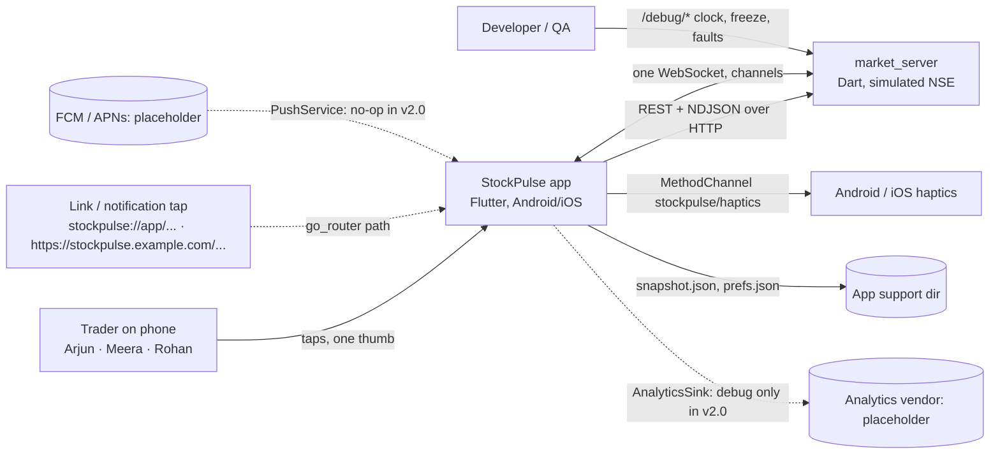
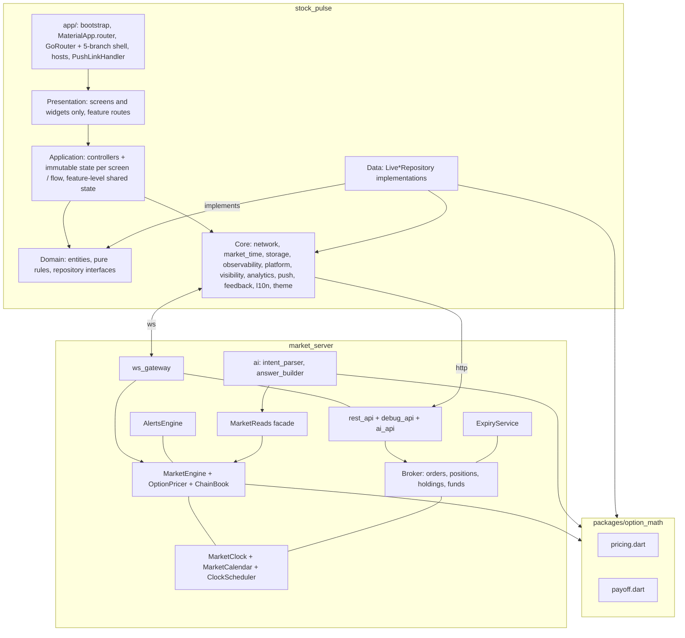
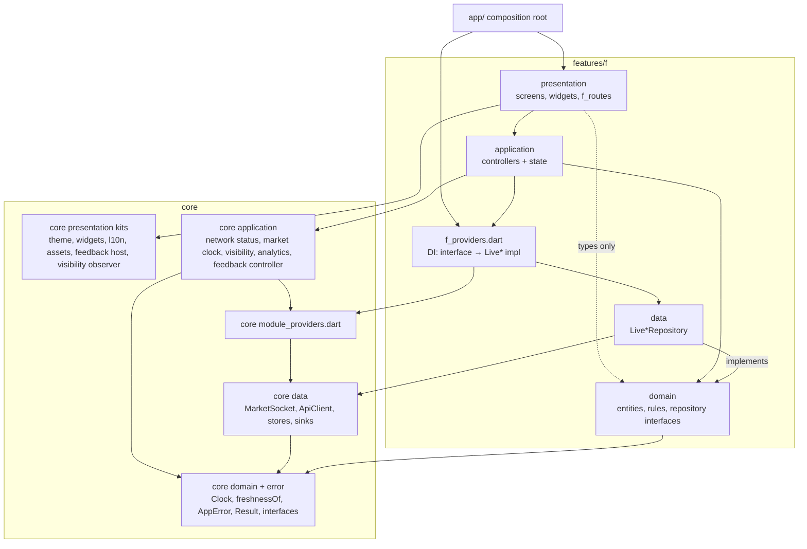
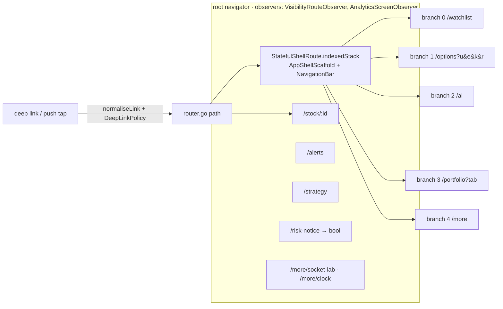

# 05 · HLD: StockPulse v2

Owner: architect · Status: **v2.1, CR-1** (change log §0) · Input: `04-trd.md` v2.0, PRD v1.1 (+ v1.4 CR-1 FRs in progress), UX v1.3, design system v1.4, `09-change-request-1.md`, ADR-0001…0021
Next: LLD updates in `docs/06-lld/` (CR-1 impact in `06-lld/README.md` §6), refactor stories R-0…R-4.

## 0. Change log

| Version | Date | Change |
|---|---|---|
| v1.0 | 2026-11-06 | Converge round: containers, protocol, lifecycle, §10.2 binding interfaces |
| v1.1 | 2026-11-06 | LLD review, decisions D1–D13 (§10.2 change log) |
| **v2.0** | 2026-11-07 | **CR-1.** Four layers per feature with an application layer; repository interfaces in domain; providers at feature level (ADR-0009). Layered core; `core/navigation` deleted; `lib/app/` is the composition root (ADR-0010). `core/providers.dart` deleted (ADR-0011). `Result` = `Success`/`Failure`, errors = `AppError` (ADR-0012). Package imports (ADR-0013). 300-line limit + coding rules (ADR-0014). go_router with a 5-branch `StatefulShellRoute` replaces `AppShell` and the openers' `Navigator` code (ADR-0015, reverses TRD v1.0 "no go_router"). Deep links + `PushService` (ADR-0016). `AnalyticsService` (ADR-0017). `AppStrings`, `AppImages`, `AppIcons` (ADR-0018). `FeedbackController`, one snackbar (ADR-0019). 100 % coverage gate (ADR-0020). Lint set (ADR-0021). Sections changed: §1, §2, §4 (rewritten, §4.1–4.4 new), §7, §8, §9, §10.1, §10.2 (v2.0), §10.3 |
| **v2.1** | 2026-11-07 | Stories v2.0 questions (scrum-master). **D14** `features/chart/` is a ninth feature folder with the four layers; file owners in §4.1 and `06-lld/README.md` §6.4 (one owner per file). **D15** indicator maths (SMA, EMA, VWAP, RSI, BB, MACD) stay in `features/chart/domain/indicators/` (pure Dart, layer-tested), not in `option_math` or a new package: only the app uses them; the server and the AI answers do not. Move to a package only when a second consumer appears. **D16** S-71 Fibonacci → dev-ai; Fibonacci is a two-anchor drawing, so dev-trading's S-55 builds the generic path and dev-ai adds only the levels and the painter (`06-lld/README.md` §6.4). **D17** ADR-0019 rule 3 amended to FR-157: `FeedbackPriority { info, error, orderOutcome }`, a lower message waits in one slot (newest wins). **D18** FR-160 wording follows ADR-0018 (hand-written `AppStrings`, no ARB, no gen_l10n); PRD change asked of the PM. Sections changed: §4.1, §10.2 (feedback) |

## 1. Context


No external system is live: no broker, exchange, LLM, push or analytics vendor. Everything is simulated (PRD §1.2). Dotted
lines are v2.0 placeholders with interfaces and no-op or debug implementations (ADR-0016, ADR-0017).

## 2. Containers



## 3. Server modules (`market_server/lib/src/`)

| Module | Role | Owner |
|---|---|---|
| `market_clock.dart` | `wallNow()`, `marketNow()`, `jumpTo(t)`, `delay(d)`; modes demo/real (ADR-0002) | dev-realtime |
| `market_calendar.dart` | Pure: `phaseAt`, `isTradingDay`, `expiries`, holiday table with source date | dev-realtime |
| `clock_scheduler.dart` | Fires day roll 09:00, open 09:15, square-off 15:20, settle + close 15:30; replays crossed boundaries on forward jump (≤ 10 days); backward only via reset | dev-realtime |
| `instruments.dart`, `option_instruments.dart` | 50 equities + NIFTY; fixed 41-strike set per (underlying, expiry) per day | dev-realtime |
| `market_engine.dart`, `option_pricer.dart`, `chain_book.dart` | Ticks, IEP in pre-open, no ticks when Closed; BS from smile; per-session field diffs | dev-realtime |
| `broker.dart`, `expiry_service.dart` | (symbol, product) positions, holdings, funds, SL, phase rules, `version`, `clientKey`; settlement idempotent by `settlementId` | dev-realtime (rules agreed with dev-trading) |
| `alerts_engine.dart` | One-shot crossing `prev < level <= ltp` (and mirror); `alertId`, `triggeredAt` | dev-realtime |
| `ws_gateway.dart` | Channels, flush 250 ms, `ka` 1 s, `resync` op, caps (100 quotes, 2 chains), per-session account routing | dev-realtime |
| `rest_api.dart`, `debug_api.dart` | v1 + `/chain`, `/holdings`, `/funds`, `/alerts`, `/clock`, `/orders?key=`; `/debug/*` FR-121…124 + `faultInjection()` | dev-realtime |
| `ai/` (`intent_parser`, `answer_builder`, `ai_api`) + `market_reads.dart` | NDJSON answers from the read-only facade | dev-ai (facade by dev-realtime) |

## 4. Client structure (`stock_pulse/lib/`) — v2.0

### 4.1 Folder map and owners

```
lib/
  main.dart                       void main() => bootstrap();
  app/                            composition root (dev-perf): imports anything, imported only by main.dart
    bootstrap.dart  app.dart      MaterialApp.router, theme, localizations, builder hosts
    router/                       app_router.dart (goRouterProvider), app_shell_scaffold.dart, deep_link.dart
                                  (normaliseLink, DeepLinkPolicy), analytics_screen_observer.dart
    push_link_handler.dart        PushService taps → router.go
    order_outcome_listener.dart   alert_banner_host.dart   (dev-trading; mounted by app.dart)
  core/
    error/                        result.dart (Success | Failure), app_error.dart            flat · dev-realtime
    config/  format/              AppConfig · formatters                                     flat · dev-realtime / dev-trading
    network/                      domain/ data/ application/ network_providers.dart          layered · dev-realtime (api_client_lines: dev-ai)
    market_time/                  domain/ data/ application/ market_time_providers.dart      layered · dev-realtime
    storage/                      domain/ data/ application/ storage_providers.dart          layered · dev-perf
    observability/                domain/ data/ observability_providers.dart                 layered · dev-perf
    visibility/                   domain/ application/ presentation/                         layered · dev-perf
    analytics/                    domain/ data/ application/ analytics_providers.dart        layered · dev-perf
    push/                         domain/ data/ push_providers.dart                          layered · dev-perf
    feedback/                     domain/ application/ presentation/                         layered · dev-trading
    platform/                     domain/ data/ platform_providers.dart  (haptics)           layered · dev-trading
    l10n/                         app_strings.dart, strings/, locales/en/, delegate          flat kit · dev-trading (+ area owners)
    assets/                       app_images.dart, app_icons.dart                            flat kit · dev-trading
    theme/  widgets/              SpColors, SpTypography, AppTheme · shared widgets          flat kit · dev-trading
  features/<f>/                   for f in market, options, orders, portfolio, alerts, ai_chat, strategy, more, chart (v2.1)
    <f>_providers.dart            repository providers typed as domain interfaces (DI, feature level)
    domain/                       entities (+ JSON), pure rules, repository interfaces, route args
    data/                         Live*Repository implementations
    application/                  <name>_state.dart, <name>_controller.dart (+ provider), derived providers
    presentation/                 screens, widgets/, <f>_routes.dart (GoRoutes, location helpers, open*)
```

`domain/` and `data/` may be subdivided into cohesive folders such as `entities/`, `models/`, `repositories/`, `dto/`,
`dao/` and `datasources/`; keep folder depth proportional to the number of related files. Meaningful business use cases
belong in `domain/usecases/`; a straightforward single-repository operation can stay in its controller. Feature-level
repository providers remain in `<f>_providers.dart`.

| Feature | domain + data + DI | application + presentation |
|---|---|---|
| `market` | dev-realtime | dev-trading (watchlist, stock page; the chart moves to `features/chart/` in S-53) |
| `options`, `orders`, `portfolio`, `alerts` | dev-realtime (trading's `order_draft`, `order_validator`, `confirm_block`, `portfolio_summary` stay dev-trading) | dev-trading |
| `ai_chat`, `strategy` | dev-ai | dev-ai |
| `more` (settings, developer: Socket Lab, debug clock) | dev-realtime (`DebugClient`, frames stream in core) | dev-perf |
| `chart` (v2.1, D14; split by file, `06-lld/README.md` §6.4) | dev-realtime: `domain/chart_store.dart`, `data/**`, `chart_providers.dart` · dev-ai: `domain/indicators/**`, `domain/fib_levels.dart` · dev-trading: other `domain/` files | dev-ai: `application/studies/**`, `presentation/studies/**`, `presentation/drawings/fib_painter.dart` · dev-trading: the rest |

`features/socket_lab/` (v1) moves under `features/more/` in R-4 (dev-perf, approved C12). Route args move to the owning
feature's `domain/`: `OrderTicketArgs` → `orders`, `ChainArgs` → `options`, `AlertArgs` → `alerts`, `StrategyArgs` →
`strategy` (already there). `InstrumentId` → `market/domain`.

### 4.2 Dependency rules


Arrows are allowed imports; everything else is forbidden. Hard rules, checked by `test/architecture/layer_rules_test.dart`
(TR-28): presentation never imports `data/` or any `*_providers.dart`; application never imports `data/`, `material` or
`widgets`; domain imports no Flutter except `foundation`, no riverpod, `http` or `dart:io`; `core/` never imports
`features/` or `app/`. Full table: ADR-0009.

### 4.3 Navigation (go_router, ADR-0015) and deep links (ADR-0016)


- Branches build on first visit (`preload: false`), stay built, and sit under `TickerMode(false)` when inactive (TR-13).
- Route `name` = `ScreenId.x.name`; `screenVisibleProvider(ScreenId)` is unchanged in signature. Inputs: `selectedTabProvider`
  (mirror of `navigationShell.currentIndex`, written only by `AppShellScaffold`, post-frame) and `coveredStateProvider`
  (from `VisibilityRouteObserver` on the root navigator).
- `open*` helpers keep their §10.2 names and live in each feature's `presentation/<f>_routes.dart`. `openStock` uses
  `pushReplacement` when the top route is the stock page (D4 rule). `openChain` = `context.go(OptionsRoutes.chain(args))`.
- Sheets and dialogs are not routes. Links never place, change or cancel orders and never carry a price.

### 4.4 Cross-cutting services (application layer owns the calls)

| Service | Module | Called by | Never called by |
|---|---|---|---|
| `FeedbackController.show(FeedbackMessage)` (one snackbar, ADR-0019) | `core/feedback` | controllers, `PushLinkHandler` | widgets |
| `AnalyticsService.log(AnalyticsEvent)` (fan-out to sinks, consent, ADR-0017) | `core/analytics` | controllers, router observers, `PushLinkHandler` | widgets |
| `PushService` (no-op, ADR-0016) | `core/push` | `PushLinkHandler` only | features |
| `AppStrings` (`context.strings` / `stringsProvider`, ADR-0018) | `core/l10n` | widgets (`context.strings`), controllers building messages (`stringsProvider`) | data, domain |
| `AppImages`, `AppIcons` (ADR-0018) | `core/assets` | widgets | everyone else |
| `CrashReporter.log` | `core/observability` | data, application, app | widgets |

## 5. Socket protocol summary (ADR-0001, ADR-0002)

| Item | Rule |
|---|---|
| Ops (client → server) | `subscribe` / `unsubscribe` with `channel` = `quotes` (symbols, mode, throttleMs), `chain` (underlying, expiry, fromStrike, toStrike, fields, throttleMs), `orders`, `alerts`; `resync`; `ping` |
| Frames (server → client) | `welcome` {sessionId, serverTime, flushMs, keepAliveMs, clock}; `ticks`; `chain` kind `snapshot`/`delta`/`status`; `ka`; `clock`; `order`, `position`, `funds`, `settlement`, `alert`; `ack`, `error`, `pong` |
| `seq` | Per session, +1 on every frame except `pong`/`ack`/`error`. Gap → client sends `resync`; values from frames with seq < snapshot seq are never applied |
| `asOf` | Frame-level server wall time; confirms every subscribed value in the frame; frozen items in `ex` {id: lastAsOf}. `ka` every 1 s lists items not otherwise confirmed. Quote `t` stays = last trade time (display only) |
| Clock frame | `serverTime`, `marketTime`, `marketOffsetMs`, `phase`, `mode`, `tradingDay`, `nextPhaseAt`; sent on welcome, phase change, jump |
| Resync | Quotes + chain: socket `resync` → fresh `ticks` + `chain` snapshots. Orders/positions/funds/alerts: REST reload, merged by `version` / `alertId`; then `resyncCompleted` |
| Account frames | Only to sessions subscribed to `orders`/`alerts` (fixes v1 broadcast). `order` carries `version` and `clientKey` |
| Caps | 100 quote ids, 2 chain subs per session; `throttleMs` 250 default, 1000 for chat cards; merged min across ref-count holders |
| Wire size | Chain delta ≈ 1.9 KB / flush, watchlist ≈ 3.7 KB / flush (TRD §3) |

## 6. AI NDJSON stream (ADR-0006)

```mermaid
sequenceDiagram
  participant C as AiChatController
  participant R as AiRepository (ApiClient.postLines)
  participant S as ai_api (async* generator)
  C->>R: ask(question, context)
  R->>S: POST /api/v1/ai/ask (AbortableRequest)
  S-->>R: {"e":"start",answerId,intent,serverTime}
  S-->>R: {"e":"card",card:{id,type,v,asOf,instruments,actions,body}}
  S-->>R: {"e":"delta",cardId,text} (every ~40 ms)
  S-->>R: {"e":"done",cards:n} | {"e":"error",code,retryable}
  R-->>C: AnswerStarted / CardAdded / TextDelta / AnswerDone / AnswerFailed
  Note over C: deltas coalesced to 50 ms; stream ends without done → interrupted
  C->>R: stop() → abortTrigger completes → server generator stops (activeAiAnswers → 0)
```
Limits: ≤ 4 cards, ≤ 8 KB per answer, 10 s to first byte, 15 s idle. Unknown `type` or `v` > supported → `UnknownCard` rendered
from `fallbackText`. Card actions carry `instrumentId`, `side`, `lots: 1`; never a price; there is no `place_order` kind.

## 7. Startup sequence (TR-14, ADR-0005)

```mermaid
sequenceDiagram
  participant M as main()
  participant C as SnapshotStore
  participant UI as MaterialApp.router + shell
  participant S as MarketSocket
  M->>M: mark main_start; install CrashReporter (sync)
  M-->>C: start read() (not awaited)
  M->>UI: runApp(ProviderScope(overrides: snapshotFuture, prefsFuture))
  UI->>UI: GoRouter resolves initial location (/watchlist or the launch deep link)
  UI->>UI: first frame: shell + first branch skeleton
  UI-->>UI: post-frame: PushService.init(), initialMessage() → router.go (no await before runApp)
  par
    C-->>UI: snapshot → watchlist/portfolio seed (fromCache, stale) → mark cache_painted
  and
    UI->>S: marketSocketProvider read on first build → connect
    S-->>UI: welcome{serverTime, clock} → ServerClock offset, status Live → mark socket_welcome
    S-->>UI: first ticks → row live → mark first_live_tick_painted
  and
    UI->>UI: REST instruments + positions (replace cached rows)
  end
```
Only the first branch is built (Watchlist, or the branch a deep link targets). The others build on first visit
(`preload: false`). go_router, `AppStrings` (const, synchronous delegate) and the no-op push/analytics add no awaited
work before the first frame (TR-14).

## 8. Stream lifecycle (ADR-0004)

1. A controller opens its repository stream in `build` **only while** `screenVisibleProvider(id)` is true; it `ref.listen`s that
   provider and cancels / re-listens the stream on flips. State is kept while hidden.
2. Visible = tab selected (`selectedTabProvider`, mirror of the go_router shell index) AND `VisibilityRouteObserver` (root
   navigator, `GoRouter(observers:)`) reports no opaque route above the screen. Bottom sheets and dialogs are non-opaque:
   the stock page stays live under the ticket.
3. The ticket and alert-create controllers own their own quote subscriptions (traded contract + underlying); the risk notice
   is opaque and pauses the chain, and the 300 ms linger bridges the hand-off.
4. Repository ref-count drop → 300 ms linger → `MarketSocket` unsubscribe (or re-send with the new min `throttleMs`).
5. Re-listen inside the linger: nothing is sent and no value is marked stale. After a real release, replayed values keep their
   old `asOf`, so §3.1 ages them normally; the subscribe ack brings fresh values within one RTT.
6. Chat cards: `LiveWhenVisible` mounts the price `Consumer` when ≥ 50 % of the card is inside the viewport (checked on scroll,
   200 ms throttle) AND `screenVisibleProvider(ScreenId.ai)`; `liveQuoteProvider` is autoDispose.
7. Background: v1 `pause()` within 2 s; snapshot saved in `onHide`.
8. Freshness timer: `freshnessTickProvider` (250 ms, autoDispose) is watched only by visible screens, so hidden screens stop ticking.

## 9. Failure modes

| Failure | Detection | Behaviour |
|---|---|---|
| Socket drop / half-open | close event; no frame > 12 s (v1 heartbeat) | Reconnecting badge; banner when last frame > 5 s (FR-90); backoff + jitter; resubscribe |
| Seq gap | seq ≠ last + 1 | `resync` op + REST reload; `resyncCompleted` |
| One symbol frozen | listed in `ex`, absent from `ka` | that instrument stale; its Confirm blocked; others live |
| Lost order ack | POST timeout | same-key retry ≤ 2; `order` frame with `clientKey` resolves early; else Pending + `GET /orders?key=` |
| Duplicate fill / alert | (orderId, status) / `alertId` seen-set | one notice, one haptic, one banner |
| Server restart | connect fails, then welcome with new session | live ≤ 10 s; REST reload; subs restored once (NFR-11) |
| Clock jump | `clock` frame | market time moves, wall time does not: no false stale; scheduler replays boundaries; settlement idempotent |
| Corrupt / old cache | decode error, schema, > 7 days | delete, one `cache_discarded` log, network load |
| AI error mid-stream | `error` event or stream end without `done` | keep cards, "Answer interrupted · Retry" |
| Haptics missing | `MissingPluginException` | no-op, logged once |
| Contract expired / unknown | `chain status expired`, metadata miss | chain moves to next expiry; ticket "Contract data unavailable" |
| Unknown or refused deep link / push link | `DeepLinkPolicy` miss, router `onException` | go to `/watchlist`, one `linkNotFound` feedback message, `deepLinkOpened` not logged |
| Repeated failing taps | same `FeedbackMessage.key` on screen | one snackbar; repeats ignored (ADR-0019) |
| Analytics sink throws or hangs | sink future error | caught, reported to `CrashReporter`; caller never waits (ADR-0017) |

## 9a. Observability

`CrashReporter` (`recordError`, `log`) with `DebugCrashReporter` (ring of 100 for the overlay) and `FakeCrashReporter`.
Timeline marks (TRD §6) via `PerfMarks`; per-frame marks behind `kPerfProbe`. One `PERF {json}` log line per run joined with
`start_up_info.json` by `tool/perf/startup.sh`. Server: `/debug/subscriptions` and `activeAiAnswers`. Results table in docs (NFR-15).

## 10. LLD split

### 10.1 Who writes what

| LLD file | Author | Covers |
|---|---|---|
| `docs/06-lld/realtime.md` | dev-realtime | Server modules §3 (minus `ai/`), protocol frames and JSON, `MarketClock`/calendar/scheduler, pricing, settlement, debug hooks FR-120…124, client `MarketSocket`, `ServerClock`, `freshnessOf`, all repositories except AI/strategy, `option_math/pricing.dart` |
| `docs/06-lld/trading.md` | dev-trading | Theme extensions + `MarketColors` migration, feature routes + `open*` helpers (market, options, orders, portfolio, alerts), `core/feedback`, `core/l10n` + `core/assets` scaffolding, watchlist + stock page screens, chain screen, order ticket state machine, risk notice, portfolio/orders, alerts UI + banner queue, haptics channel (Kotlin/Swift) |
| `docs/06-lld/ai.md` | dev-ai | `ai/` server module and NDJSON, `postLines`, `AiRepository`, chat controller/cards, `ai_chat`/`strategy` routes, `StrategyDraftController`, `LiveWhenVisible`, strategy builder, `PayoffChart`, `option_math/payoff.dart` |
| `docs/06-lld/perf.md` | dev-perf | `main()`, `app/router` (GoRouter, shell scaffold, deep links, `PushLinkHandler`), `core/visibility`, `core/analytics`, `core/push`, platform deep-link config, CI scripts (file length, coverage, layer test, lints), `SnapshotStore`/`LocalPrefs`, `CrashReporter`, marks/probe, perf harness and scripts, debug overlay, More/Settings shell |

Each LLD lists files, classes with fields, provider declarations, tests per FR, and cites the interfaces below **verbatim**.
A change to any §10.2 signature needs an architect-approved edit of this section first.
v2.0: every LLD also shows its layer split (domain / data / application / presentation), the DI file, and a file list
with every file ≤ 300 lines (ADR-0009, ADR-0014).

### 10.2 Shared interfaces (names and signatures are binding) — v2.0

**Change log v2.0 (CR-1):**
| # | Change | ADR |
|---|---|---|
| C1 | `Result<T>` = `Success<T>(value)` \| `Failure<T>(error)`; `Failure` (error) → `AppError` (`NetworkError`, `ServerError`, `ParseError`); `valueOrNull` added. Every `Future<Result<...>>` below reads with these names | 0012 |
| C2 | Repository names below are **domain interfaces** (`features/<f>/domain/<f>_repository.dart`); implementations `Live*Repository` in `data/`; providers in `features/<f>/<f>_providers.dart` | 0009 |
| C3 | Provider locations moved (paths in the block); `core/providers.dart` deleted | 0009–0011 |
| C4 | `appShellControllerProvider` → `selectedTabProvider` (mirror of the go_router shell; no public `select`); D1 replaced by `context.go` / `navigationShell.goBranch` | 0015 |
| C5 | Openers keep names and signatures, implemented over go_router in `features/<f>/presentation/<f>_routes.dart`; `rootNavigatorKey` moves to `app/router/`; `chainTargetProvider` removed (`ChainArgs` travels as query) | 0015 |
| C6 | Args move to feature domains; `ChainArgs.toQuery/fromQuery` added | 0010, 0015 |
| C7 | `StrategyDraftRepository` → `StrategyDraftController` (application, `Notifier<StrategyDraft>`); `addLeg`/`clear` unchanged, `load(StrategyArgs)` added | 0009 |
| C8 | New: `goRouterProvider`, `PushService`, `AnalyticsService`/`AnalyticsSink`/`AnalyticsEvent`, `FeedbackController`/`FeedbackMessage`, `AppStrings`/`stringsProvider`, `AppImages`/`AppIcons`, `LocalPrefsData.analyticsConsent` | 0015–0019 |

**Change log v1.1** (history):

**Change log v1.1 (LLD review, decisions D1–D12 in `06-lld/README.md`):**
| # | Change | Asked by |
|---|---|---|
| D1 | Tab switch API = dev-perf's `appShellControllerProvider.notifier.select(ScreenId)`; no `shellTabProvider` | dev-trading |
| D2 | Added repository calls: `getInstrument`, `getInstruments`, portfolio `watch*`/`get*`/`current`, orders `getOrders`/`cancel`, alerts `list`/`create`/`delete`/`watchAll` | dev-trading, dev-perf |
| D3 | Snapshot read-only getters `watchlistIds`, `latestQuotes`, `PortfolioRepository.current`; `PortfolioSummary` leaves the snapshot (derived) | dev-perf |
| D4 | Every opener pushes with `RouteSettings(name: ScreenId.x.name)`; `openStock` uses `pushReplacement` when the top route is `stockDetail` | dev-perf |
| D5 | `addLeg(contractId, side, premium)` → `added | full | otherChain`; `otherChain` changes nothing | dev-ai |
| D6 | `ChainRequest` stays 4 fields; chain throttle fixed 250 ms; `OptionCell.iv`/`delta` always populated at ≤ 1 Hz | dev-realtime, dev-ai |
| D7 | Backward debug jump → 409; go back with `POST /debug/reset {time}` (also resets the account); `DebugClient` added | dev-realtime |
| D8 | `OrderRepository.place` = one attempt; same-key retries (≤ 2) belong to the ticket | dev-realtime |
| D9 | `ka` re-emits quotes equal by `==` with a new `asOf`; widgets `select` price fields or `Freshness`, never `asOf` | dev-realtime |
| D10 | `AlertArgs.direction: AlertDirection?` → `condition: AlertCondition?` (one enum with the server) | architect |
| D11 | `ApiClient.send(BaseRequest)` added (dev-realtime); `postLines` is an extension in its own file (dev-ai) | architect |
| D12 | `MarketReads` shape added (server, dev-realtime; consumer dev-ai) | dev-ai |

```dart
// core/error (dev-realtime) — v2.0 C1
sealed class Result<T> {}   final class Success<T> extends Result<T> { final T value; }
final class Failure<T> extends Result<T> { final AppError error; }
extension ResultX<T> on Result<T> { T getOrThrow(); Result<R> map<R>(R Function(T) f); T? get valueOrNull; }
sealed class AppError implements Exception { String message; }   // NetworkError · ServerError(statusCode, code) · ParseError

// core/market_time (dev-realtime): domain/, data/, application/, market_time_providers.dart
abstract interface class Clock { DateTime now(); }                       // SystemClock, FakeClock
final clockProvider = Provider<Clock>((ref) => const SystemClock());     // market_time_providers.dart
class ServerClock { ServerClock(Clock device); DateTime now(); Duration get offset;
  void onWelcome(int serverTimeMs, DateTime receivedAt);
  void onPong(int sentTsMs, int serverTimeMs, DateTime receivedAt); }
final serverClockProvider = Provider<ServerClock>(...);                  // market_time_providers.dart
enum MarketPhase { preOpen, open, closed }
class MarketClockState { MarketPhase phase; int marketOffsetMs; String mode; String tradingDay;
  DateTime? nextPhaseAt; DateTime marketNow(DateTime serverNow); }
final marketClockProvider = StreamProvider<MarketClockState>(...);       // application/
enum Freshness { live, stale, closed }
const kStaleAfter = Duration(seconds: 5);                                // age > 5.0 s is stale
Freshness freshnessOf({required DateTime? asOf, required bool fromCache, required DateTime serverNow,
  required bool socketLive, required MarketPhase phase});               // domain/, pure
final freshnessTickProvider = StreamProvider.autoDispose<DateTime>(...); // application/, serverNow every 250 ms

// core/network (dev-realtime): domain/, data/, application/, network_providers.dart
enum NetworkStatus { live, reconnecting, offline }
final networkStatusProvider = StreamProvider<NetworkStatus>(...);        // application/
final apiClientProvider = Provider<ApiClient>(...);  final marketSocketProvider = Provider<MarketSocket>(...);
final debugClientProvider = Provider<DebugClient>(...);                  // all three: network_providers.dart
SocketSubscription MarketSocket.subscribeQuotes(Iterable<String> ids, FeedMode mode, {int throttleMs = 250});
ChainSubscription MarketSocket.subscribeChain(ChainRequest req);       // updateRange(from, to), cancel()
AccountSubscription MarketSocket.subscribeAccount({bool orders = true, bool alerts = true});
Stream<SocketMessage> get MarketSocket.messages;  DateTime? get MarketSocket.lastFrameAt;
Future<http.StreamedResponse> ApiClient.send(http.BaseRequest req);      // adds auth header (dev-realtime)
extension ApiClientLines on ApiClient { Stream<Map<String, Object?>> postLines(String path, Object body); } // dev-ai, core/network/data/api_client_lines.dart
abstract interface class DebugClient { Future<Result<MarketClockState>> setClock(DateTime marketTime);  // 409 backward_jump_requires_reset
  Future<Result<void>> reset({DateTime? marketTime}); }

// features/*/domain = interfaces below (dev-realtime); data/ = Live*Repository; DI = features/<f>/<f>_providers.dart — v2.0 C2
class Quote { String id; double ltp, change, changePct, prevClose; DateTime asOf; int seq; bool fromCache; ... } // == excludes asOf, seq
abstract interface class MarketRepository {
  Stream<List<Quote>> watchQuotes(List<String> ids, FeedMode mode, {int throttleMs = 250}); // ka re-emits (D9)
  Future<Result<Instrument>> getInstrument(String id);                // 404 → ServerError → "Contract data unavailable"
  Future<Result<List<Instrument>>> getInstruments({InstrumentKind? kind, String? underlying});
  List<String> get watchlistIds;  void setWatchlist(List<String> ids); // calls markStructuralDirty
  List<Quote> latestQuotes(Iterable<String> ids);  void seedFromCache(List<Quote> cached); }
final marketRepositoryProvider = Provider<MarketRepository>(...);       // features/market/market_providers.dart
final liveQuoteProvider = StreamProvider.autoDispose.family<Quote, ({String id, int throttleMs})>(...); // features/market/application/live_quote_provider.dart
class ChainRequest { String underlying; String expiry; int fromStrike; int toStrike; }   // D6
class OptionCell { String contractId; double ltp, change; int oi, oiChange; double? iv, delta; } // no asOf field
class ChainRow { int strike; OptionCell? ce; OptionCell? pe; }
class ChainView { String chainId; int seq; DateTime asOf; double spot; int atm; ChainStatus status;
  List<int> strikes; Map<int, ChainRow> rows; Map<String, DateTime> exAsOf; DateTime asOfFor(String contractId); }
abstract interface class ChainFeed { Stream<ChainView> get views; void setVisibleRange(int fromStrike, int toStrike); }
abstract interface class ChainRepository { ChainFeed watchChain(ChainRequest req);
  Future<Result<List<Expiry>>> expiries(String underlying); }          // chainRepositoryProvider: options_providers.dart
sealed class PlaceOutcome {}  // PlaceAcked(Order) · PlaceRejected(String code, String message) · PlaceTimedOut()
abstract interface class OrderRepository {                             // orderRepositoryProvider: orders_providers.dart
  Future<PlaceOutcome> place(OrderRequest req, {required String idempotencyKey, Duration timeout}); // D8: one attempt
  Future<Result<Order?>> getOrder({String? id, String? clientKey});
  Stream<Order> get updates;  Stream<void> get resyncCompleted;
  Future<Result<List<Order>>> getOrders();  Future<Result<Order>> cancel(String id); }
class Order { String id; String? clientKey; int version; ... }   // full field list: 06-lld/realtime.md §7.4
class PortfolioBook { List<Position> positions; List<Holding> holdings; Funds? funds; }
abstract interface class PortfolioRepository {                         // portfolioRepositoryProvider: portfolio_providers.dart
  Stream<List<Position>> watchPositions();  Stream<List<Holding>> watchHoldings();
  Stream<Funds> watchFunds();  Stream<Settlement> get settlements;
  Future<Result<List<Position>>> getPositions(); Future<Result<List<Holding>>> getHoldings(); Future<Result<Funds>> getFunds();
  PortfolioBook? get current; }                                        // read-only, for SnapshotScheduler
// Position, Holding: toJson/fromJson owned by dev-realtime. PortfolioSummary.compute(positions, holdings, quotes) is pure (dev-trading), not cached
enum AlertCondition { above, below }
abstract interface class AlertsRepository {                            // alertsRepositoryProvider: alerts_providers.dart
  Future<Result<List<PriceAlert>>> list();  Stream<List<PriceAlert>> watchAll();
  Future<Result<PriceAlert>> create(String symbol, AlertCondition cond, double level);
  Future<Result<PriceAlert>> delete(String alertId);
  Stream<PriceAlert> get triggered; }                                  // deduped by alertId against LocalPrefs.seenAlertIds

// core/visibility, storage, observability (dev-perf)
enum ScreenId { watchlist, options, ai, portfolio, more, stockDetail, strategy, alerts }   // domain/; = GoRoute names
final selectedTabProvider = NotifierProvider<SelectedTabNotifier, ScreenId>(...);  // v2.0 C4; written only by AppShellScaffold
final coveredStateProvider = NotifierProvider<CoveredStateNotifier, CoveredState>(...); // written only by VisibilityRouteObserver
final screenVisibleProvider = Provider.family<bool, ScreenId>(...);  // unchanged contract (ADR-0004)
final snapshotProvider = FutureProvider<AppSnapshot?>(...);           // overridden in bootstrap()
abstract interface class SnapshotStore { void markStructuralDirty(); Future<void> saveNow(AppSnapshot s); Future<void> clear(); }
class LocalPrefsData { bool riskNoticeAcked; bool hapticsEnabled; bool analyticsConsent; Set<String> seenAlertIds;
  String? lastChainUnderlying; Locale? localeOverride; }               // copyWith; v2.0 adds analyticsConsent, localeOverride
abstract interface class LocalPrefs { LocalPrefsData get data;
  Future<void> update(LocalPrefsData Function(LocalPrefsData current) change); Future<void> clear(); }
final localPrefsProvider = FutureProvider<LocalPrefs>(...);          // overridden in bootstrap(), read lazily
abstract interface class CrashReporter { void recordError(Object e, StackTrace s, {bool fatal = false, String? reason});
  void log(String event, [Map<String, Object?> data]); }
abstract final class PerfMarks { static void mark(String name, {int? seq}); }
abstract final class PaintProbe { static void mark(int seq); }        // no-op unless kPerfProbe

// app/router (dev-perf) — v2.0 C5, ADR-0015/0016
final goRouterProvider = Provider<GoRouter>(...);                     // StatefulShellRoute.indexedStack, 5 branches
Uri normaliseLink(Uri link);                                          // stockpulse://app/x → /x ; https host → path
abstract final class DeepLinkPolicy { static bool allows(Uri location); } // /watchlist /options /ai /portfolio /stock/:id /alerts

// feature routes + openers (dev-trading; strategy/ai: dev-ai) — features/<f>/presentation/<f>_routes.dart
enum OrderSource { manual, chain, position, alert, ai }
class OrderTicketArgs { String instrumentId; OrderSide side; int? lots; ProductType? product; double? limitPrice; OrderSource source; } // orders/domain
class AlertArgs { String instrumentId; AlertCondition? condition; double? price; OrderSource source; }   // alerts/domain
class ChainArgs { String underlying; String? expiry; int? strike; OptionRight? right;                   // options/domain
  Map<String, String> toQuery(); static ChainArgs? fromQuery(Map<String, String> q); }                  // v2.0 C6
class StrategyArgs { List<StrategyLeg> legs; }   class StrategyLeg { String contractId; OrderSide side; int lots; double premium; }
abstract final class MarketRoutes { static String stock(String instrumentId); }   // + OptionsRoutes.chain(ChainArgs), PortfolioRoutes.portfolio({tab})
Future<void> openOrderTicket(BuildContext context, OrderTicketArgs args);   // risk notice first for F&O: push<bool>('/risk-notice')
Future<void> openChain(BuildContext context, ChainArgs args);              // context.go(OptionsRoutes.chain(args))
Future<void> openAlertCreate(BuildContext context, AlertArgs args);        // sheet, not a route
Future<void> openStock(BuildContext context, String instrumentId);         // pushReplacement if top route is stockDetail (D4)
Future<void> openStrategyBuilder(BuildContext context, StrategyArgs args); // draft.load(args) then push('/strategy')
enum AddLegResult { added, full, otherChain }
final strategyDraftControllerProvider = NotifierProvider<StrategyDraftController, StrategyDraft>(...); // v2.0 C7, strategy/application
AddLegResult StrategyDraftController.addLeg(String contractId, OrderSide side, double premium);  // otherChain changes nothing
void StrategyDraftController.clear();  void StrategyDraftController.load(StrategyArgs args);

// core/push (dev-perf) — ADR-0016
class PushMessage { String id; String? title, body; Uri? link; Map<String, String> data; }
abstract interface class PushService { Future<void> init(); Future<String?> token(); Future<PushMessage?> initialMessage();
  Stream<PushMessage> get onTap; Stream<PushMessage> get onForeground; }
final pushServiceProvider = Provider<PushService>((ref) => const NoopPushService());

// core/analytics (dev-perf) — ADR-0017
class AnalyticsEvent { String name; Map<String, Object> params; }   abstract final class Events { ... }   // catalogue
abstract interface class AnalyticsSink { String get id; Future<void> log(AnalyticsEvent e);
  Future<void> setUserProperty(String name, String? value); Future<void> reset(); }
final class AnalyticsService { void log(AnalyticsEvent e); }          // fire-and-forget fan-out, consent-gated
final analyticsSinksProvider = Provider<List<AnalyticsSink>>(...);  final analyticsProvider = Provider<AnalyticsService>(...);

// core/feedback (dev-trading) — ADR-0019
enum FeedbackKind { info, success, error }   enum FeedbackPriority { info, error, orderOutcome }   // v2.1, FR-157
class FeedbackMessage { String key; String text; FeedbackKind kind; String? actionLabel; FeedbackAction? action; bool persist;
  FeedbackPriority priority; }   // default from kind; lower priority waits in one slot (newest wins), ADR-0019 rule 3
sealed class FeedbackAction {}  // OpenLocation(String path) · ReplyToSender(String actionId)
final feedbackControllerProvider = NotifierProvider<FeedbackController, FeedbackMessage?>(...);
void FeedbackController.show(FeedbackMessage m);  void FeedbackController.dismissed(String key);
Stream<FeedbackReply> get FeedbackController.replies;               // FeedbackHost is the only showSnackBar caller

// core/l10n, core/assets (dev-trading; each area's strings by its owner) — ADR-0018
abstract interface class AppStrings { CommonStrings get common; MarketStrings get market; OptionsStrings get options;
  OrderStrings get orders; PortfolioStrings get portfolio; AlertStrings get alerts; AiStrings get ai; MoreStrings get more;
  ErrorStrings get errors; }
AppStrings appStringsFor(Locale locale);   extension L10nX on BuildContext { AppStrings get strings; }
final localeProvider = NotifierProvider<LocaleNotifier, Locale>(...);  final stringsProvider = Provider<AppStrings>(...);
abstract final class AppImages { static const String logo; ... }   abstract final class AppIcons { static const IconData watchlist; ... }

// core/theme (dev-trading)
class SpColors extends ThemeExtension<SpColors> { ... Color directionOf(num change); }
class SpTypography extends ThemeExtension<SpTypography> { TextStyle price, priceDense, change, strike, caption; }
extension SpThemeX on BuildContext { SpColors get sp; SpTypography get spText; }
abstract interface class Haptics { Future<void> success(); Future<void> rejection(); }   // core/platform/domain

// packages/option_math (pricing: dev-realtime, payoff: dev-ai)
double bsPrice({required OptionRight right, required double spot, required double strike,
  required double years, required double iv, double rate = 0.065});
Greeks greeks({...same args});   double yearsToExpiry(DateTime marketNow, DateTime expiryAt);
double payoffAtExpiry(List<PayoffLeg> legs, double spot);
PayoffSummary payoffSummary(List<PayoffLeg> legs);   // exact kinks: maxProfit?, maxLoss? (null = unlimited), breakevens, netPremium
double valueToday(List<PayoffLeg> legs, double spot, DateTime marketNow);

// market_server/lib/src/market_reads.dart (dev-realtime; consumer dev-ai's ai/) — v1.1 (D12), unchanged
abstract interface class MarketReads { DateTime wallNow(); DateTime marketNow(); MarketPhase phase();
  Instrument? instrument(String idOrAlias); List<Instrument> instruments(); QuoteRead? quote(String id);
  ChainRead? chainSnapshot(String underlying, {String? expiry, int around = 2}); List<String> expiries(String underlying);
  List<QuoteRead> topMovers(int n, {bool losers = false}); List<Candle> candles(String id, Duration interval, {int limit = 75}); }
// ChainRead { underlying, expiry, expiryAt, asOf, spot, pcr, atm, strikeStep, lotSize, maxPain, maxCallOiStrike, maxPutOiStrike, rows }
// QuoteRead { id, kind, ltp, change, changePct, prevClose, asOf }  ChainRowRead { strike, ce, pe }  ChainCellRead { id, ltp, oi, iv }
```

### 10.3 Order of work

| Step | Work | Who | Unblocks |
|---|---|---|---|
| 1 | Stubs of every §10.2 type (compiling, fakes included); `option_math` skeleton + tests for `bsPrice`; theme extensions + `MarketColors` removal | all four, in parallel | everyone |
| 2 | M-A: test hooks FR-120…124, `MarketClock`/calendar/scheduler, protocol v2 (`welcome.serverTime`, `asOf`, `ka`, channels, `resync`), `ServerClock`, `freshnessOf` | dev-realtime | QA, steps 3–5 |
| 2' | M-A: `main()`, crash hook, marks, `SnapshotStore`, `LocalPrefs`, `AppShell` + `ScreenVisibility` + FR-82/86 tests | dev-perf | steps 3–5 |
| 2'' | M-A: haptics channel + `FakeHaptics`, openers, watchlist on new `Quote` | dev-trading | — |
| 3 | M-B: chain channel + pricing (realtime) → chain screen, ticket, risk notice, F&O positions, settlement UI (trading) | dev-realtime → dev-trading | J-2 |
| 4 | M-C: holdings, funds, alerts server (realtime) → portfolio summary, alerts UI, banner queue (trading) | dev-realtime → dev-trading | J-3, J-5 |
| 5 | M-D: `MarketReads` (realtime) → `ai/` server, chat, cards, `payoff.dart`, builder (dev-ai) | dev-realtime → dev-ai | J-4 |
| 6 | Perf runs on device, NFR table, fixes | dev-perf with owners | release gate |

**v2.0 insert, before wave 1 resumes:** refactor wave W1R (stories R-0 → R-1a → R-1b ∥ R-2 ∥ R-3 ∥ R-4, see
`06-lld/README.md` §6). Gates (file length, coverage, layer test, `--fatal-infos`) turn blocking at the W1R exit.
