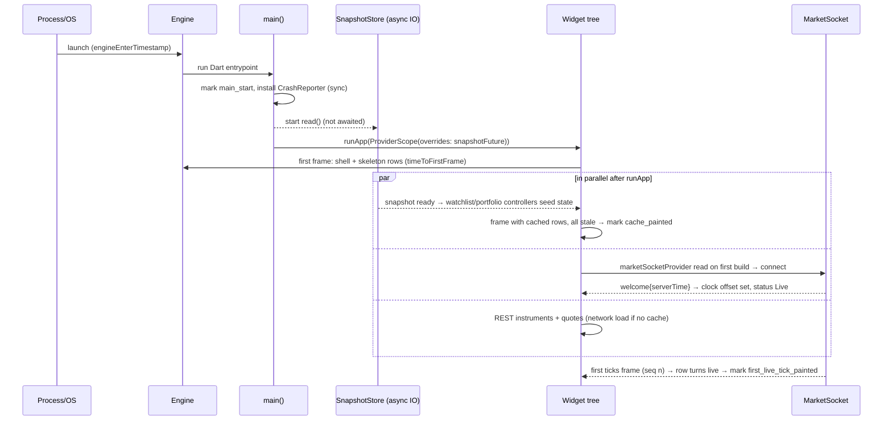

# Proposal: startup, performance and observability (dev-perf)

## 1. Scope
FR-80, FR-81, FR-82, FR-85, FR-86, FR-87, FR-114, FR-125 (marks), FR-63 (unsubscribe timing, shared with dev-ai), NFR-1…NFR-6, NFR-14, NFR-15, NFR-16. Not owned: stale rule maths (§3.1, dev-realtime), order-sheet block (FR-38, dev-trading).

## 2. Startup sequence
`main()` awaits nothing. It records `main_start`, installs the crash hook, **starts** the cache read (a `Future`) and calls `runApp` in the same turn. The cache future is handed to a provider override, so the first frame never waits on disk.

Synchronous before `runApp`: binding init, `Stopwatch`, crash hook, `Future` creation. Everything else is parallel. Fonts are bundled (no runtime fetch). No splash delay, no `await SharedPreferences.getInstance()`.

## 3. Snapshot cache
**Decision: one JSON file** `snapshot.json` in the app support directory, via `dart:io` (FR-80 already says one file).
- New dependency: **`path_provider`** (only to get the support directory; no codegen, maintained by the Flutter team). Its call is async and runs inside the read future, not before `runApp`.
- Rejected: `shared_preferences` (string blobs, Android writes the whole XML, async init tempts an await in main); `sqflite`/`drift` (schema, migrations, native lib and startup cost for one document; drift needs codegen).

Format (hand-written `toJson`/`fromJson` on immutable `AppSnapshot`):
`{schemaVersion: 1, savedAt (server-adjusted ms), watchlist: {symbols[], quotes{symbol: {ltp, change, changePct, prevClose, asOf}}}, positions[], holdings[], summary, lastChainUnderlying}`. Instrument metadata is **not** cached for trading (lot size, band come fresh from REST, NFR-9); only display names.

- **Size budget**: ≤ 64 KB (50 quotes + ~50 positions/holdings ≈ 20 KB). Encode/decode on the UI isolate (< 2 ms measured at 64 KB on Pixel 6a is the gate); move to `Isolate.run` only if the test shows > 4 ms.
- **When saved**: on `AppLifecycleListener.onHide` (same place as socket pause), every 30 s while Live **only if dirty**, and after a resync. Atomic write: `snapshot.json.tmp` then `rename`. Single writer (`SnapshotStore`), last write wins; writes are skipped while one is in flight.
- **Invalid cache** (FR-87): `schemaVersion` ≠ current, `savedAt` > 7 days, or decode error → delete file, report one `CrashReporter.log('cache_discarded', reason)`, network load, no crash. No migrations: a version bump just discards.
- **Stale marking**: seeded quotes carry `origin: QuoteOrigin.cache`. The stale evaluator (dev-realtime) treats `origin == cache` as stale regardless of age (§3.1 third clause); the first live frame for that symbol replaces it with `origin: live`. Rows show grey + "as of hh:mm" from `asOf`.
- **Buy/Sell**: buttons stay enabled (FR-12); the sheet's Confirm reads the same evaluator, so a cached quote blocks with "Price not live since hh:mm:ss" until the first live frame (FR-38, FR-92). Positions/holdings from cache are display-only until `GET /positions` returns; Exit on a cached row opens the sheet, which then blocks the same way.
- FR-112 reset deletes the file.

## 4. Lazy tabs and stream lifecycle
- Replace the eager `IndexedStack` with a **lazy IndexedStack**: a `Set<int> _visited`; unvisited tabs are `SizedBox.shrink()` (FR-82: no `OptionChainScreen` in the tree, chain provider 0 listeners). Visited tabs stay built so scroll position is kept (FR-86).
- Hidden tabs are wrapped in `TickerMode(enabled: index == current)`. Covered routes under an opaque route already get `TickerMode(false)` from the Overlay. **Riverpod 3 pauses listeners of widgets whose TickerMode is off**; a provider whose listeners are all paused gets `ref.onCancel`, then `ref.onResume` on return.
- Rule for every price controller (one per screen): open the socket stream in `build`, and in `ref.onCancel` cancel the stream subscription; in `ref.onResume` re-listen. The repository ref-count drops → `MarketSocket` sends unsubscribe when the count reaches 0. State is kept (not disposed), values are marked `origin: resumed` → stale until a fresh frame (repository replays `_latest` only as stale).
- **Linger 300 ms** in the repository before sending unsubscribe, so a quick tab flick does not churn the server; still inside the 1 s of FR-63/NFR-14.
- Non-opaque routes (order sheet, dialogs) keep the screen below live: the order sheet needs the stock quote.
- Fallback if Riverpod pausing proves flaky in tests: an explicit `ScreenVisibility` inherited widget (tab index && `ModalRoute.isCurrent`) the controller listens to. Decided by the FR-86 test, not by taste.
- Background (FR-85): unchanged `pause()`/`resume()`; add a snapshot save in `onHide`, and test 0 subs at 2 s with the fake clock (FR-124).
- Rebuild budget: rows `select` their own quote (kept); `TickPrice` flash uses a `RepaintBoundary`; list uses `itemExtent` fixed rows; no `Opacity`/`saveLayer` in rows.

## 5. Measurement plan
| NFR | Command / harness | Where | Pass |
|---|---|---|---|
| 1 | `tool/perf/startup.sh`: 10 × (`adb shell am force-stop`, `flutter run --profile --trace-startup --device-id <6a>`) → `build/start_up_info.json` `timeToFirstFrameMicros` | manual, device | p50 ≤ 800 ms, p90 ≤ 1.2 s |
| 2, 3 | Same runs; app emits marks with `Timeline.now` (same clock as `engineEnterTimestampMicros`) and prints one `PERF {json}` log line; script joins logcat with `start_up_info.json` | manual, device | p50 ≤ 1.0 s / ≤ 2.0 s |
| 4, 5 | `integration_test/perf/watchlist_perf_test.dart`, `chain_perf_test.dart`: `binding.traceAction` around a 20 s scripted fling, `TimelineSummary.summarize(...).writeTimelineToFile` → p90 build/raster, missed budget count. Run via `flutter drive --profile --driver=test_driver/perf_driver.dart` | manual, device; 5 runs median | p90 < 16.7 ms (report 16 ms too), missed ≤ 1 % |
| 6 | Socket-to-paint probe (below), 3 × 60 s | manual, device | p90 ≤ 50 ms |
| 14 | Integration tests with `GET /debug/subscriptions` | CI (macOS/Linux, TestServer) | exact counts |
| 16 | DevTools memory snapshots at 1 and 10 min, chain open | manual | RSS ≤ 250 MB, heap Δ ≤ 10 MB |

**Socket-to-paint probe** (compiled out unless `--dart-define=PERF_PROBE=true`, a `const bool`): socket marks `frame_received(seq)` on decode; the probed row, when it builds a quote with a new seq, registers `addPostFrameCallback` capturing the frame number; `SchedulerBinding.addTimingsCallback` matches that frame's `FrameTiming.rasterFinish` and marks `price_painted(seq)` with raster end, so the latency includes raster. Results collected as p50/p90 in the PERF log line.

**CI (every PR, macOS runner, debug/test mode)**: FR-80/81/82/86/87 widget + integration tests on TestServer, rebuild-counter tests for NFR-4/5 ("row A built once, others 0"), cache encode/decode micro-benchmark with a 64 KB fixture (fails if > 4 ms on CI as a coarse guard). Emulators/simulators and macOS never produce NFR numbers (§5.1). Device runs fill the NFR-15 table: device, OS, build SHA, date, medians.

## 6. Observability
- `abstract interface class CrashReporter { void recordError(Object e, StackTrace s, {bool fatal, String? reason}); void log(String event, [Map<String, Object?> data]); }`, provided by `crashReporterProvider`. Implementations: `DebugCrashReporter` (`debugPrint` + in-memory ring of 100 for the debug overlay) and `FakeCrashReporter` (tests count calls, FR-87 "1 log"). A real Crashlytics/Sentry class would only implement the interface.
- Wired in `main()` before `runApp`: `FlutterError.onError` and `PlatformDispatcher.instance.onError` → reporter (NFR-15). Not `runZonedGuarded` (zone mismatch warnings with bindings).
- Trace marks (`Timeline.instantSync`, names fixed by FR-125): `main_start`, `cache_read_done`, `cache_painted`, `socket_welcome`, `first_live_tick_painted`, `frame_received(seq)`, `price_painted(seq)`. A `StartupMarks` object keeps the same values for the FR-114 overlay (profile/debug only).

## 7. Interfaces
- **dev-realtime**: I need `welcome.serverTime` → `ServerClock.offset` set before any live/stale decision; `Quote.asOf` and an `origin` field (`live | cache | resumed`) honoured by the stale evaluator; socket marks `frame_received(seq)` at decode; repository linger-unsubscribe (300 ms) and replay-as-stale on re-listen; `debug/subscriptions` counts for tests.
- **dev-trading**: portfolio and watchlist controllers accept a seed `AppSnapshot?` and must expose dirty state to `SnapshotStore`; order sheet Confirm uses the shared evaluator so `origin: cache` blocks; cached positions are read-only until REST returns; never cache orders (FR-31a: truth is `GET /orders`).
- **dev-ai**: chat history is **not persisted** (FR-66: session only, kill clears); no entry in the snapshot. Cards follow the same `onCancel/onResume` rule for FR-63 visibility (≥ 50 % visible via a visibility hook on the card, then ref-counted quote path).

## 8. Risks and rejected alternatives
| Risk | Mitigation |
|---|---|
| `path_provider` first call slow on cold Android (channel init) | It is inside the un-awaited future; NFR-2 budget measured end to end |
| Riverpod pause semantics change or don't fire for routes | FR-86 test with sub counts; explicit `ScreenVisibility` fallback |
| Cached price mistaken for live | `origin` enforced by one evaluator; widget test at cold start: Confirm disabled |
| Concurrent writes/corrupt file on kill | tmp + rename, single writer; corrupt → discard path (FR-87) |
| 120 Hz phones mask jank | Pixel 6a forced to 60 Hz; report native budget separately |

Rejected: awaiting the cache before `runApp` (adds disk IO to NFR-1); `sqflite`/`drift`/`hive` (codegen or native weight for one document); `shared_preferences` (see §3); keeping the eager `IndexedStack` (breaks FR-82/86); disposing hidden tabs (loses scroll, refetches); `visibility_detector` for tabs (TickerMode already exists; may be used only for AI cards).

## 9. Critiques and answers (round 2)
**Answers given**
- dev-ai (marks): add `ai_first_card_painted` (post-frame after the first `CardAdded` card builds) and `ai_stream_done` (instant at `AnswerDone`). 50 ms delta coalescing agreed. New `integration_test/perf/chat_perf_test.dart` (scroll with 2 live cards, 5 runs), reported against the NFR-4 rule, not gating. The AI and builder tabs are covered by the FR-82 lazy test.
- dev-trading (visibility): `screenVisibleProvider(ScreenId)` ships as the primary signal.
- dev-realtime: `fromCache` bool adopted.

**Critiques sent**
- dev-ai: `visibility_detector` cannot see hidden tabs or covered routes. Live = fraction ≥ 0.5 **and** `screenVisibleProvider(ScreenId.ai)`. Detector 300 ms + linger 300 ms ≈ 0.6 s, which meets FR-63.
- dev-trading: microtask coalescing gives one state emit per socket frame, not per vsync. That is fine at the 250 ms flush, so no vsync batching. The 250 ms stale timer must stop while the screen is hidden. `price_painted` covers only one probed contract behind `const PERF_PROBE`, through a `PaintProbe.mark(seq)` helper; no post-frame callback per cell. The build counter is test-only.
- dev-realtime: `_merge` must let the first live frame replace a `fromCache` value whatever its seq (unit test). Put the `frame_received` mark behind `PERF_PROBE`. Keep the welcome handler light; the socket connects about one frame after `runApp`, which fits NFR-3.

**Changes to this proposal**
- §4: the explicit `screenVisibleProvider(ScreenId)` replaces Riverpod TickerMode pausing as the primary mechanism; TickerMode pausing becomes the backup. It is true when the tab is selected and `ModalRoute.isCurrent` (via a `RouteObserver`). Non-opaque sheets do not count as covering: the order sheet keeps its quote live. Controllers `ref.listen` it and cancel or re-listen their streams.
- §3/§7: `origin` enum dropped. `Quote.fromCache` (dev-realtime) marks cached values. Values replayed after re-listen are stale through the normal age rule, because no keep-alive arrives while unsubscribed.
- §6: marks list gains `ai_first_card_painted`, `ai_stream_done`. All per-frame marks are behind `const PERF_PROBE`.
